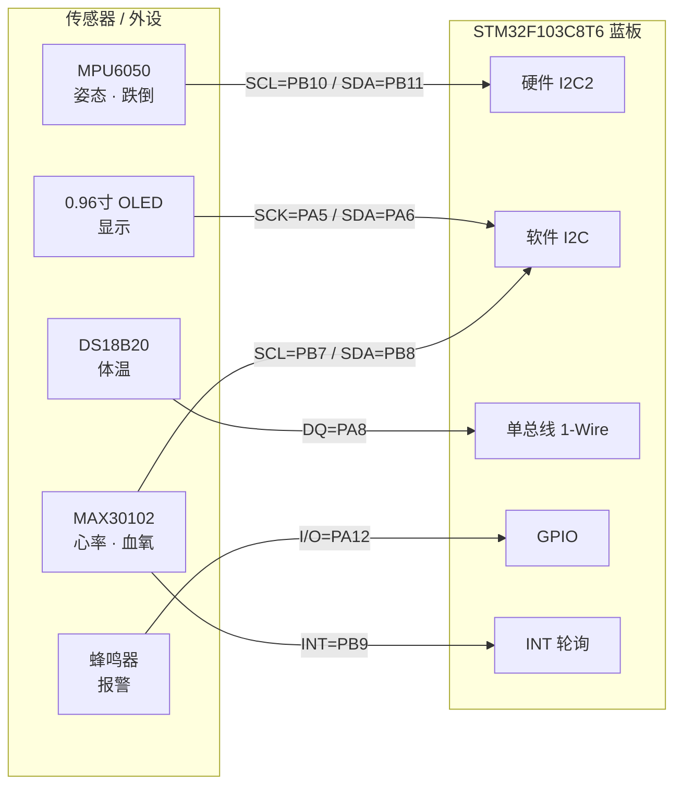
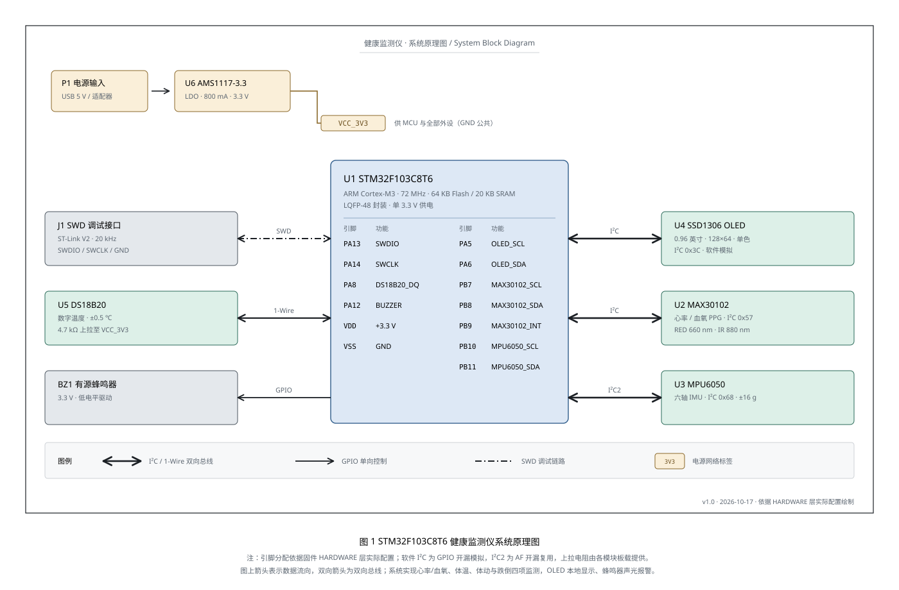

<div align="center">

# 小组嵌入式 · STM32 健康监测

**STM32F103C8T6（蓝板）心率 + 血氧 + 体温 + 跌倒检测** · 复用正点原子标准库工程

</div>

基于 [B站 `BV1mT421a79w`](https://www.bilibili.com/video/BV1mT421a79w)（UP：嵌入式学习君）开源源码二次整理，补全仓库级文档、Mermaid 原理图与一键编译脚本。

## 功能一览

| 模块 | 器件 | 关键引脚 | 说明 |
|------|------|----------|------|
| 心率 / 血氧 | MAX30102 | SCL=PB7, SDA=PB8, INT=PB9 | 软件 I2C，Maxim 算法，500 点缓冲 |
| 体温 | DS18B20 | DQ=PA8 | 单总线，整数度 |
| 姿态 / 跌倒 | MPU6050 | SCL=PB10, SDA=PB11 | 硬件 I2C2 | 
| 显示 | 0.96" OLED | SCK=PA5, SDA=PA6 | 中文字库 |
| 报警 | 有源蜂鸣器 | I/O=PA12 | GPIO 驱动 |
| (预留) | ESP32 第二主板 | USART1(PA9/PA10) | 数据上传/联网 |

## 系统接线图

> GitHub 原生支持 Mermaid，此处可直接渲染；完整方案（含电源/上拉/搭建清单）见 [board/schematic.md](board/schematic.md)。



## 目录结构

```
小组嵌入式/
├─ board/              接线与原理图（Mermaid） + 组件清单图组件部分.png
├─ docs/               架构说明、算法分析、ESP32 集成方案
│  ├─ debug/           调试报告（实机证据链 + 故障速查表 + 仿真固件说明）
│  └─ schematic/       系统原理图（SVG 精修版 + 引脚分配表）
├─ firmware/
│  ├─ MAX30102/        【实物】正点原子标准库 Keil 工程（USER/IIC.uvprojx）
│  │  └─ gcc/          独立于 Keil 的 GCC 构建系统 + 诊断固件
│  └─ MAX30102_sim/    【仿真】Proteus 专用工程，目录结构与上面一致
│                      └─ USER/main.c 为仿真逻辑（不接传感器）
├─ sim/
│  ├─ proteus/         SIT_sim.pdsprj + 被加载的 IIC.hex
│  └─ wokwi/           Wokwi 网页版方案（diagram.json + sketch.ino）
├─ scripts/
│  └─ build.ps1        一键编译脚本 → firmware/MAX30102/OBJ/IIC.hex
├─ README.md
└─ LICENSE
```

## 快速开始（编译）

### 方式 A：Keil MDK（原始工程）

需要 Keil MDK v5（V5.06 编译器已测）+ STM32F1xx DFP。

```powershell
powershell -ExecutionPolicy Bypass -File scripts\build.ps1
```

产物：`firmware\MAX30102\OBJ\IIC.hex`（首行 `:020000040800F2`，烧录地址 0x0800 0000）。
编译结果：`0 Error(s), 0 Warning(s)`（原 `main.c` 中未使用的 `temp_num`、`str` 已清理）。

### 方式 B：arm-none-eabi-gcc（无需 Keil 授权）

`firmware/MAX30102/gcc/` 提供一套完整可用的 GCC 构建系统，产出 `.elf / .hex / .bin`，
并额外提供**实时诊断固件**与**带超时保护的业务固件**。四种构建变体：

```bash
cd firmware/MAX30102/gcc
SHELL=/usr/bin/bash mingw32-make.exe -j4        # IIC  原业务固件（含 MAX30102）
SHELL=/usr/bin/bash mingw32-make.exe -j4 APP=1  # APP  业务固件（已实测跑通）
SHELL=/usr/bin/bash mingw32-make.exe -j4 LIVE=1 # LIVE 实时诊断（每 3 秒全量复扫）
SHELL=/usr/bin/bash mingw32-make.exe -j4 DIAG=1 # DIAG 一次性诊断
```

详见 [`firmware/MAX30102/gcc/README.md`](firmware/MAX30102/gcc/README.md)。

## 仿真（Proteus）

仿真工程：`sim/proteus/SIT_sim.pdsprj`，加载 `sim/proteus/IIC.hex`。

仿真里的器件与实物**并不等价**：没有 MAX30102 / MPU6050，DS18B20 实际加载的是 `DS1822.MDF`
模型（单总线命令写不进去，读回恒为 `0xFFFF`），MCU 模型的 `CLOCK_SCALE` 也只有 8（≈64 MHz）。
所以另立了一份**仿真专用固件**，实物固件一行未改：

| 功能 | 仿真里的数据源 | 引脚 |
|---|---|---|
| 温度 | **RV2 电位器**（0~3.3 V 映射 15~45 ℃），ADC 读不到时退回软件模拟 | PA0 / ADC1_IN0 |
| 心率 | 固件内置节律 66~90 BPM | — |
| 血氧 | 占位 97 | — |
| 跌倒 | SW3 开关（20 ms 去抖） | PB1 |
| 蜂鸣器 | 跌倒时长鸣（低电平驱动） | PA12 |

OLED 第 2 行右侧标数据来源：`POT` = 电位器 / `SIM` = 软件模拟 / `DS18` = 真传感器。

```bash
# 编译仿真固件
"C:/Keil_v5/UV4/UV4.exe" -b "$PWD/firmware/MAX30102_sim/USER/IIC.uvprojx" -j0 -o build.log

# 部署给 Proteus（它固定加载这个路径）
cp firmware/MAX30102_sim/OBJ/IIC.hex sim/proteus/IIC.hex
```

原理、限制与"换回真传感器"的做法见
[`docs/debug/10-仿真固件说明.md`](docs/debug/10-仿真固件说明.md)。

## 系统原理图

系统级原理图（含电源域、四类外设与 SWD 调试链路）：

[](docs/schematic/系统原理图_v1.0.md)

## 硬件调试记录

实机调试过程与故障根因分析收录在 [`docs/debug/`](docs/debug/README.md)，含：

- 固件**无超时死等**导致 OLED 黑屏的定位过程（`ds18b20.c:68`）；
- **RC 电容探针法**判定"这根针上到底插没插线"的原理与实测数据；
- ST-Link/OpenOCD 链路参数（`adapter speed 20`）与 USB 重枚举恢复手法；
- **Proteus 仿真的坑**：蜂鸣器 `Exclude from Simulation`、DS1822 模型读回 `0xFFFF`、
  `CLOCK_SCALE` 与 72 MHz 不符导致心率偏差 12.5%（`10`）；
- 10 份报告 + 一张**故障速查表**（现象 → 根因 → 修复）。

## 说明

- firmware 内驱动/CORE/FWLib 源自正点原子(ALIENTEK)，其版权头注"仅供学习使用"，本仓库仅作学习整理。
- 完整接线与原理图见 [board/schematic.md](board/schematic.md)，硬件搭建前请先核对 OLED 接口类型与蜂鸣器是否有源。