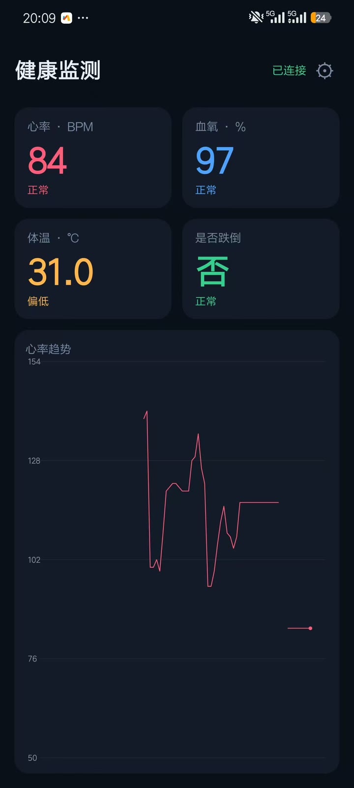
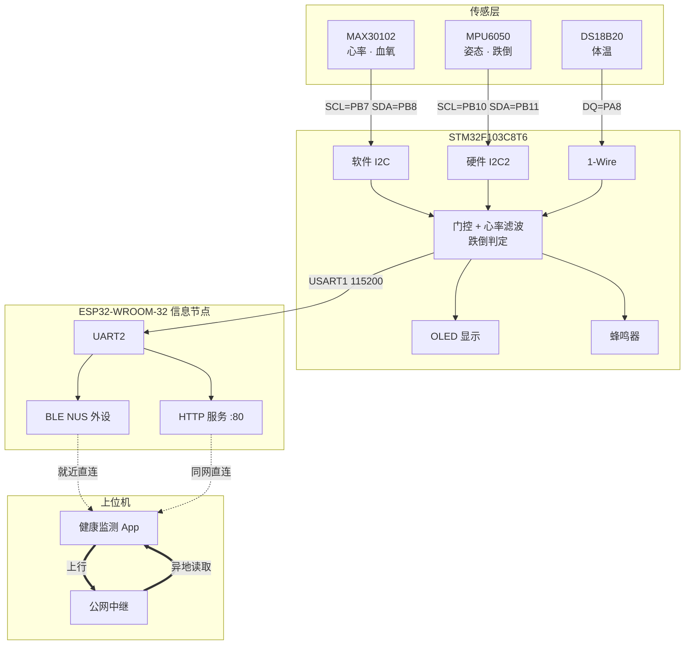
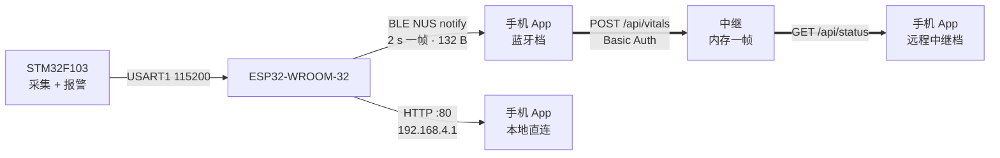
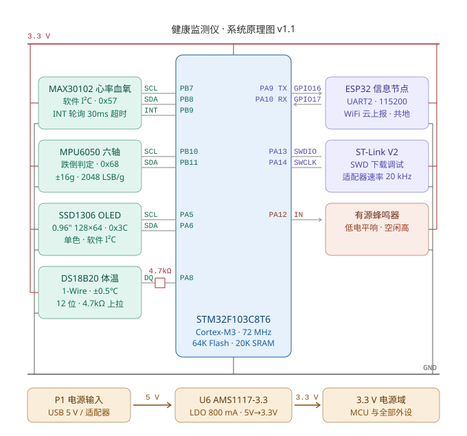

<div align="center">

# STM32 健康监测仪 + ESP32 信息节点

**心率 · 血氧 · 体温 · 跌倒** 采集，OLED 本地显示，蜂鸣器报警，三档链路送达手机

[](https://github.com/PandaGuGu/stm32-health-monitor/releases)
[](LICENSE)
[](https://github.com/PandaGuGu/stm32-health-monitor)
[](https://github.com/PandaGuGu/stm32-health-monitor)


</div>

## 目录

- [简介](#简介)
- [界面](#界面)
- [系统架构](#系统架构)
- [三种连接方式](#三种连接方式)
- [硬件与接线](#硬件与接线)
- [快速开始](#快速开始)
- [仓库结构](#仓库结构)
- [文档索引](#文档索引)
- [实测数据](#实测数据)
- [已知限制](#已知限制)
- [许可证](#许可证)

## 简介

两块板：STM32F103C8T6 负责采集与本地报警，ESP32-WROOM-32 负责联网与上报。

- **采集**：MAX30102 心率/血氧、DS18B20 体温、MPU6050 跌倒判定，0.96" OLED 本地显示，异常触发蜂鸣器
- **信号质量门控**：IR 直流、交流幅度、灌流指数、接触时间、心率区间五项同时满足才出数，无手指时显示保持最后一次有效读数
- **三种送达方式**：局域网直连、公网中继异地查看、蓝牙就近直连，同一份固件、同一个 App
- **跌倒独立报警通道**：跌倒瞬间信号门控失效也不会丢帧，App 弹窗 + 常驻记录 + 每 5 s 重发到云端
- **双固件**：实物固件接真传感器，仿真固件给 Proteus 用，两者互不影响
- **证据链**：10 份硬件调试报告 + 一张故障速查表，每条结论都能追到实测数据

STM32 侧基于 [B站 `BV1mT421a79w`](https://www.bilibili.com/video/BV1mT421a79w)（UP：嵌入式学习君）开源源码二次整理；
ESP32 侧、上位机与远程中继为本项目自研。

## 界面

<table>
<tr>
<td align="center"><br><sub>监测面板</sub></td>
<td align="center"><br><sub>跌倒记录（常驻）</sub></td>
<td align="center"><br><sub>跌倒弹窗</sub></td>
</tr>
</table>

手机端首页只有读数与趋势，链路配置收进右上角【设置】。界面说明、设置项矩阵与跌倒报警规则见
[docs/app/README.md](docs/app/README.md)。

## 系统架构



## 三种连接方式

三条链路并存，按场景选一条；App 里切换即可，不需要重新编译或换固件。

| | 本地直连 | 远程中继 | 蓝牙 |
|---|---|---|---|
| 手机与设备 | 必须同网 | 任意网络 | 十米内 |
| 谁发起 | App 拉设备 | App 拉中继 | 设备通知 |
| 中间件 | 无（设备自带 HTTP） | `remote/relay_server.py` | 无 |
| 数据留存 | 无 | 中继只留最新一帧 | 无 |
| 上行云端 | 否 | 否 | 可选 |
| 典型场景 | 实验台调试、答辩演示 | 异地看护、外出携带 | 无网络环境 |



三条链路共用同一个解析函数与同一套界面，区别只在状态文字。链路设计的取舍、帧龄算法与部署方式分别在
[remote/README.md](remote/README.md)、[firmware/esp32/README.md](firmware/esp32/README.md) 与
[docs/architecture.md](docs/architecture.md) 中说明。

## 硬件与接线

| 模块 | 器件 | 引脚 | 说明 |
|---|---|---|---|
| 心率 / 血氧 | MAX30102 | SCL=PB7, SDA=PB8, INT=PB9 | 软件 I2C，INT 30 ms 超时轮询 |
| 体温 | DS18B20 | DQ=PA8 | 单总线，需 4.7 kΩ 上拉 |
| 姿态 / 跌倒 | MPU6050 | SCL=PB10, SDA=PB11 | 硬件 I2C2，`WHO_AM_I=0x68` |
| 显示 | 0.96" OLED (SSD1306) | SCK=PA5, SDA=PA6 | 中文字库 |
| 报警 | 有源蜂鸣器 | PA12 | 低电平驱动 |
| 联网 | ESP32-WROOM-32 | STM32 `USART1(PA9/PA10)` → ESP32 `UART2(GPIO16/17)` | 115200，共地 |

系统级原理图（含电源域、ESP32 节点、SWD 调试链路与逐引脚标注）：

[](docs/schematic/系统原理图_v1.1.md)

完整接线、上拉电阻与搭建清单见 [board/schematic.md](board/schematic.md)。

## 快速开始

### STM32 固件

两套构建方式，产物相同。

```powershell
# A. Keil MDK（需 Keil v5 + STM32F1xx DFP）
powershell -ExecutionPolicy Bypass -File scripts\build.ps1
# 产物：firmware\MAX30102\OBJ\IIC.hex，烧录地址 0x08000000
```

```bash
# B. arm-none-eabi-gcc（无需 Keil 授权）
cd firmware/MAX30102/gcc
SHELL=/usr/bin/bash mingw32-make.exe -j4         # 业务固件
SHELL=/usr/bin/bash mingw32-make.exe -j4 LIVE=1  # 实时诊断（每 3 s 全量复扫）
SHELL=/usr/bin/bash mingw32-make.exe -j4 DIAG=1  # 一次性诊断
```

### ESP32 固件

```powershell
powershell -ExecutionPolicy Bypass -File scripts\build-esp32.ps1 -Upload -Port COM3
# 启用蓝牙外设再加：-Define ENABLE_BLE=1   （必须使用 huge_app 分区，固件约 1.73 MB）
```

烧录地址 `0x00010000`，固件体积、RAM 占用与分区说明见 [firmware/esp32/README.md](firmware/esp32/README.md)。

### 上位机

```bash
python host/gateway/server.py --source mock     # 无硬件时用内置模拟器
python host/gateway/server.py --source serial --serial COM3   # 接 ESP32 串口
```

浏览器自动打开 `http://127.0.0.1:8080/`；三数据源切换、REST/SSE 接口与演示 App 的构建命令分别在
`host/gateway` 与 `host/app` 目录内。

### 远程中继

```bash
python remote/relay_server.py --port 8000 --user <账号> --pass <密码>
```

纯标准库、不落盘，一帧覆盖一帧。systemd 部署、HTTPS 与未备案机器的处理方式见 [remote/README.md](remote/README.md)。

## 仓库结构

```
stm32-health-monitor/
├─ board/              接线方案与元件清单
├─ docs/               架构、App、ESP32、调试报告、原理图
│  ├─ app/             健康监测 App：界面截图与行为说明
│  ├─ debug/           10 份硬件调试报告 + 故障速查表
│  ├─ esp32/           ESP32 节点：架构 / 协议 v1 / 调试记录
│  ├─ release/         历史发布说明
│  └─ schematic/       系统原理图（SVG + 引脚分配表）
├─ firmware/
│  ├─ MAX30102/        【实物】正点原子标准库 Keil 工程 + gcc 构建系统
│  ├─ MAX30102_sim/    【仿真】Proteus 专用工程
│  └─ esp32/           信息节点固件（Arduino）
├─ host/
│  ├─ gateway/         Python 网关：串口 / WiFi / 模拟器三源 + REST + SSE
│  ├─ app/             Android 演示 App（四档数据源）
│  ├─ app-vitals/      健康监测 App（本地工程，不入库；APK 见 Releases）
│  └─ tools/           无 STM32 时的生理数据注入工具
├─ remote/             远程监测方案：公网中继
├─ scripts/            一键编译脚本
├─ sim/                Proteus 工程与 Wokwi 方案
└─ CHANGELOG.md        版本变更
```

## 文档索引

| 文档 | 内容 |
|---|---|
| [docs/architecture.md](docs/architecture.md) | 技术基线、主循环时序、跌倒判定、三档链路设计 |
| [docs/app/README.md](docs/app/README.md) | App 界面、设置项矩阵、跌倒报警规则、数据存储 |
| [docs/esp32/architecture.md](docs/esp32/architecture.md) | ESP32 分层与关键取舍 |
| [docs/esp32/protocol.md](docs/esp32/protocol.md) | 协议 v1：信封、字段、命令、错误码 |
| [docs/esp32/debug.md](docs/esp32/debug.md) | 工具链绕行、联调问题、真机命令回归 |
| [docs/debug/](docs/debug/README.md) | 10 份硬件调试报告与故障速查表 |
| [docs/schematic/](docs/schematic/系统原理图_v1.1.md) | 系统原理图 v1.1 与引脚分配 |
| [firmware/esp32/README.md](firmware/esp32/README.md) | BLE 实现、编译参数与踩坑 |
| [firmware/MAX30102/gcc/README.md](firmware/MAX30102/gcc/README.md) | GCC 构建变体与诊断固件 |
| [remote/README.md](remote/README.md) | 中继部署、帧龄算法、故障速查 |
| [CHANGELOG.md](CHANGELOG.md) | 版本变更 |

硬件调试的核心结论（完整证据链见 [docs/debug/](docs/debug/README.md)）：

- 固件**无超时死等**导致 OLED 黑屏，根因定位到 `ds18b20.c:68`；黑屏另一个真因是扫描函数把 PA5/PA6 改成输入
- **RC 电容探针法**：用充放电曲线判定「这根针上到底插没插线」，无需拆焊
- ST-Link/OpenOCD 只有 `adapter speed 20` 是稳定档位；`LIBUSB_ERROR_TIMEOUT` 用软重枚举恢复
- Proteus 的坑：`DS1822` 模型读回恒为 `0xFFFF`，`CLOCK_SCALE=8` 会让心率偏差 12.5%

## 实测数据

| 项目 | 数值 | 条件 |
|---|---|---|
| 心率 | 89–119 BPM | 指腹压住 MAX30102，与商用指夹式对照偏差 < 3 BPM |
| 血氧 | 97 % | 同上，静态测量 |
| 帧周期 | ≈ 1.92 s | 采集 1.0 s + DS18B20 0.73 s + 其余 0.2 s |
| 坏帧率 | 0.25 % | 连续 400 帧统计 |
| BLE 吞吐 | 132 B / 2 s，MTU 517 | `stm32-vitals-XXXX` 广播 |
| ESP32 固件 | 1 732 567 B（55 %），RAM 64 596 B | `ENABLE_BLE=1` + `huge_app` |

仿真环境与实物不等价：Proteus 里没有 MAX30102 与 MPU6050，DS18B20 实际加载 `DS1822` 模型（读回恒为 `0xFFFF`），
MCU 的 `CLOCK_SCALE` 也只有 8（≈64 MHz）。因此另立 `firmware/MAX30102_sim/`，实物固件一行未改。
数据源替换与偏差量化见 [docs/debug/10-仿真固件说明.md](docs/debug/10-仿真固件说明.md)。

## 已知限制

- 报警重发只在 App 首页可见时运行，锁屏或切后台会暂停
- 一个中继只服务一个采集端；两台手机同时上报会互相覆盖同一帧
- 中继不存历史，进程重启即清空；跨端回放需要额外数据库，当前判为不必要的复杂度
- 明文 HTTP 部署时账号密码仅 base64 编码，异地使用需套 TLS
- 心率/血氧算法来自 Maxim 参考实现，跌倒阈值按实测标定，**均未经临床验证**

## 许可证

自有代码与文档以 **MIT** 发布，见 [LICENSE](LICENSE)。

第三方组件不在 MIT 覆盖范围内：`firmware/` 下的 CORE、STM32F10x_FWLib、SYSTEM、HARDWARE 源自正点原子开源工程，
版权头声明「仅供学习使用，未授权禁止用于商业用途」；ESP32 侧以 arduino-esp32（LGPL-2.1）为构建依赖，
其内部链接 ESP-IDF（Apache-2.0）与 xtensa 工具链，烧录工具为 esptool（GPL-2.0）。
完整清单与使用边界见 [THIRD-PARTY-NOTICES.md](THIRD-PARTY-NOTICES.md)。

- 学习 / 课设 / 个人实验：可自由使用、修改、再分发，保留原始版权头与本说明
- 商业用途：需另行取得正点原子及各芯片厂商授权，MIT 不能替代

**本项目不是医疗器械**，不得用于诊断或监护场景。

## 版本说明

仓库存在两套编号：`v0.0.x` 为健康监测 App 的版本（GitHub Releases 上的 tag 与 APK 文件名），
`v0.7.x` 为固件与文档的版本（[CHANGELOG.md](CHANGELOG.md)）。两者独立推进，互不覆盖。
