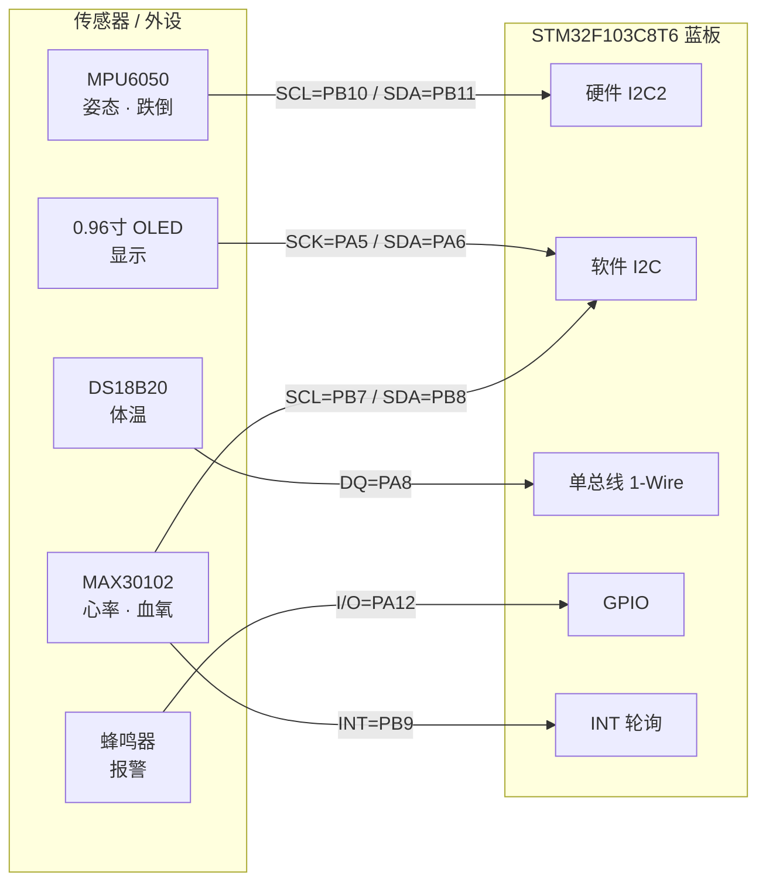
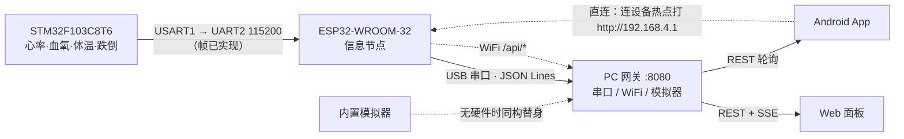
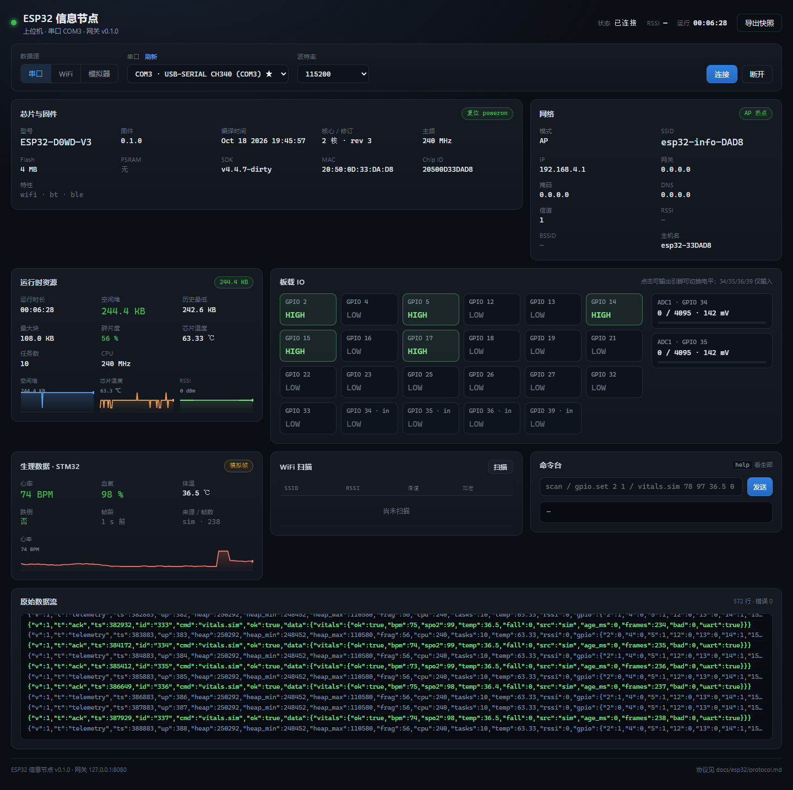
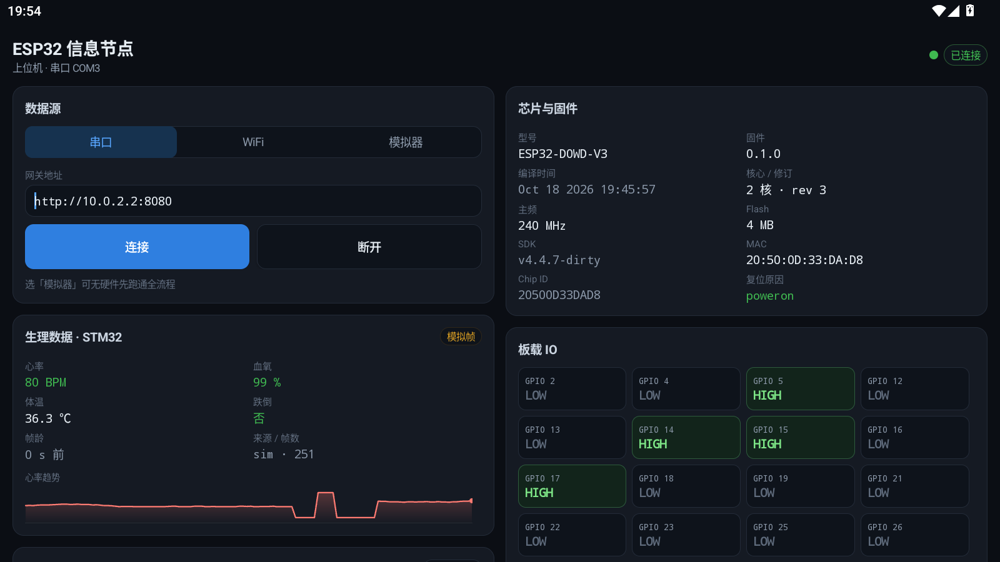
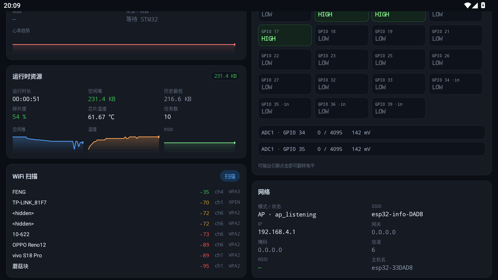

<div align="center">

# 小组嵌入式 · STM32 健康监测 + ESP32 信息节点

**STM32F103C8T6 心率·血氧·体温·跌倒** + **ESP32-WROOM-32 信息节点** + **Web / Android 上位机**

[](https://github.com/PandaGuGu/stm32-health-monitor/releases)
[](LICENSE)
[](https://github.com/PandaGuGu/stm32-health-monitor)
[](https://github.com/PandaGuGu/stm32-health-monitor)


</div>

STM32 侧基于 [B站 `BV1mT421a79w`](https://www.bilibili.com/video/BV1mT421a79w)（UP：嵌入式学习君）开源源码二次整理；
ESP32 侧与 Web / Android 上位机为本项目自研。仓库补全了 Mermaid 原理图、架构与协议文档、一键编译脚本，
以及**实机调试证据链**。

## 关于

这是一个**课程小组项目**，最终形态是两块板：STM32 做采集与本地报警，ESP32 做联网与上报。

**第一块：STM32F103C8T6 健康监测** —— MAX30102（心率/血氧）、DS18B20（体温）、MPU6050（跌倒），
OLED 本地显示，异常蜂鸣器报警。维护两套固件：

| | 固件 | 用途 |
|---|---|---|
| 🟢 实物 | `firmware/MAX30102/` | 接真传感器，已在实机跑通（心率/血氧/体温/跌倒全部实测） |
| 🔵 仿真 | `firmware/MAX30102_sim/` | 给 Proteus 用，传感器缺失部分用模拟数据补齐 |

**第二块：ESP32 信息节点 + 双端上位机** —— 先把 ESP32 独立成"只采自己状态"的节点，
把协议和上位机跑通，再回头接 STM32 的 `USART1`（避免串口/联网/上位机三个问题互相掩盖）：

| | 位置 | 用途 |
|---|---|---|
| 🟠 固件 | `firmware/esp32/` | 芯片/网络/运行时/IO 四类信息，JSON Lines 上行、文本命令下行 |
| 🟣 上位机 | `host/` | Python 网关（串口/WiFi/模拟器三源）+ Web 单页 + Android 原生 App |

**当前版本 `v0.2.0`**：ESP32 信息节点与双端上位机已完成，**真机（ESP32-D0WD-V3）串口链路与 21 条命令实测通过，STM32 生理数据链路已打通（协议+解析+双端展示）**。
版本变更见 [CHANGELOG.md](CHANGELOG.md#v020---2026-10-18)。

**范围说明**：这是学习/课设性质的项目，不是医疗器械；MAX30102 的心率/血氧算法来自
Maxim 官方参考实现，跌倒判定阈值按实测标定，但**未经临床验证**。

## 功能一览

| 模块 | 器件 | 关键引脚 | 说明 |
|------|------|----------|------|
| 心率 / 血氧 | MAX30102 | SCL=PB7, SDA=PB8, INT=PB9 | 软件 I2C，Maxim 算法，500 点缓冲 |
| 体温 | DS18B20 | DQ=PA8 | 单总线，整数度 |
| 姿态 / 跌倒 | MPU6050 | SCL=PB10, SDA=PB11 | 硬件 I2C2 | 
| 显示 | 0.96" OLED | SCK=PA5, SDA=PA6 | 中文字库 |
| 报警 | 有源蜂鸣器 | I/O=PA12 | GPIO 驱动 |
| 联网 / 上报 | ESP32-WROOM-32 | STM32 `USART1(PA9/PA10)` → ESP32 `UART2` | v0.2.0 已独立跑通信息节点；STM32 侧对接待做 |

## 系统接线图

> GitHub 原生支持 Mermaid，此处可直接渲染；完整方案（含电源/上拉/搭建清单）见 [board/schematic.md](board/schematic.md)。



## ESP32 信息节点与上位机（v0.2.0）

STM32 四路监测稳定后，下一步是按 `docs/architecture.md §5` 接 ESP32（第二主板，负责 WiFi / 云上报）。
为了避免"串口 + 联网 + 上位机"一起上、出问题互相掩盖，ESP32 先独立成一个**信息节点**：
只采自己的芯片 / 网络 / 运行时 / IO，先把「协议 + 上位机」这条链路跑通，再回头接 STM32。

| 部分 | 位置 | 说明 |
|---|---|---|
| ESP32 固件 | `firmware/esp32/esp32_info_node/` | Arduino 框架、WROOM-32、**零第三方库**；上行 JSON Lines / 下行文本命令；串口 + WiFi HTTP 双通路；编译 62% Flash、0 告警 |
| 上位机网关 | `host/gateway/server.py` | Python（标准库 + pyserial）；串口 / WiFi / **内置模拟器** 三选一；REST + SSE；串口自动重连 |
| Web 面板 | `host/web/` | 无构建单页：四类信息卡片 + 生理数据、四条 Canvas 曲线、WiFi 扫描表、命令台（带 ack）、原始 JSON 流 |
| Android App | `host/app/` | Java 原生、无第三方依赖（APK 30 KB）；四档数据源（串口/WiFi/模拟器/**直连**）；已在 MuMu 与设备热点下实测 |
| STM32 替身 | `host/tools/stm32_sim.py` | 没有 STM32 时喂生理数据：可走网关注入，也可走真串口 |







已在真机 **ESP32-D0WD-V3**（4 MB Flash / MAC `20:50:0D:33:DA:D8`）上跑通：烧录前整片备份、上电 500 ms 出首帧、
21 条命令全通（含 4 条 vitals）、`scan` 扫到真实 AP、`reboot` 后 `reset=sw` 且网关无感；Web 与 App 读到同一份真机数据。
细节见 [docs/esp32/debug.md](docs/esp32/debug.md) 第 3 节。

**没有 ESP32 也能先跑** —— 内置模拟器与真机同构，界面代码不含任何 mock 分支：

```bash
python host/gateway/server.py --source mock     # 浏览器自动打开 http://127.0.0.1:8080/
```

插上板子后（先装 CH340/CP210x 驱动）：

```bash
powershell -ExecutionPolicy Bypass -File scripts\build-esp32.ps1 -Upload -Port COM3
python host/gateway/server.py --source serial --serial COM3
```

**没有电脑也能演示** —— 设备自带与网关同构的 HTTP 服务（`source=device`）：手机连热点
`esp32-info-XXXX`（密码 `12345678`），App 选「直连」填 `http://192.168.4.1` 即可，
看数据 / 点引脚 / 跑扫描都不经过 PC：



- 架构与取舍：[docs/esp32/architecture.md](docs/esp32/architecture.md)
- 协议 v1（字段 / 命令 / 错误码 / 引脚策略）：[docs/esp32/protocol.md](docs/esp32/protocol.md)
- 搭建与调试记录（13 条速查表 + 真机命令回归）：[docs/esp32/debug.md](docs/esp32/debug.md)
- 上位机用法与接口表：[host/README.md](host/README.md)

## 目录结构

```
小组嵌入式/
├─ board/              接线与原理图（Mermaid） + 组件清单图组件部分.png
├─ docs/               架构说明、ESP32 集成方案
│  ├─ debug/           调试报告（实机证据链 + 故障速查表 + 仿真固件说明）
│  ├─ esp32/           ESP32 信息节点：架构 / 协议 v1 / 调试记录 + 三张实测截图
│  └─ schematic/       系统原理图（SVG 精修版 + 引脚分配表）
├─ firmware/
│  ├─ MAX30102/        【实物】正点原子标准库 Keil 工程（USER/IIC.uvprojx）
│  │  └─ gcc/          独立于 Keil 的 GCC 构建系统 + 诊断固件
│  ├─ MAX30102_sim/    【仿真】Proteus 专用工程，目录结构与上面一致
│  └─ esp32/           【新】ESP32 信息节点固件（Arduino，esp32_info_node/）
├─ host/               【新】上位机：gateway（Python）+ web（单页）+ app（Android）+ tools
│  ├─ gateway/         三数据源（串口/WiFi/模拟器）+ REST + SSE
│  ├─ web/             无构建 Web 面板
│  ├─ app/             Java 原生 App（零第三方依赖）
│  └─ tools/           stm32_sim.py：没有 STM32 时喂生理数据
├─ sim/
│  ├─ proteus/         SIT_sim.pdsprj + 被加载的 IIC.hex
│  └─ wokwi/           Wokwi 网页版方案（diagram.json + sketch.ino）
├─ scripts/
│  ├─ build.ps1        STM32 一键编译 → firmware/MAX30102/OBJ/IIC.hex
│  └─ build-esp32.ps1  ESP32 编译/烧录（arduino-cli）
├─ README.md
└─ LICENSE
```

## 快速开始 · STM32 编译

> ESP32 固件的编译/烧录在上一节（`scripts\build-esp32.ps1`），上位机见 [host/README.md](host/README.md)。

### 方式 A：Keil MDK（原始工程）

需要 Keil MDK v5（V5.06 编译器已测）+ STM32F1xx DFP。

```powershell
powershell -ExecutionPolicy Bypass -File scripts\build.ps1
```

产物：`firmware\MAX30102\OBJ\IIC.hex`（首行 `:020000040800F2`，烧录地址 0x0800 0000）。
编译结果：`0 Error(s), 0 Warning(s)`（原 `main.c` 中未使用的 `temp_num`、`str` 已清理）。

### 方式 B：arm-none-eabi-gcc（无需 Keil 授权）

`firmware/MAX30102/gcc/` 提供一套完整可用的 GCC 构建系统，产出 `.elf / .hex / .bin`，
并额外提供**实时诊断固件**与**带超时保护的业务固件**。四种构建变体：

```bash
cd firmware/MAX30102/gcc
SHELL=/usr/bin/bash mingw32-make.exe -j4        # IIC  原业务固件（含 MAX30102）
SHELL=/usr/bin/bash mingw32-make.exe -j4 APP=1  # APP  业务固件（已实测跑通）
SHELL=/usr/bin/bash mingw32-make.exe -j4 LIVE=1 # LIVE 实时诊断（每 3 秒全量复扫）
SHELL=/usr/bin/bash mingw32-make.exe -j4 DIAG=1 # DIAG 一次性诊断
```

详见 [`firmware/MAX30102/gcc/README.md`](firmware/MAX30102/gcc/README.md)。

## 仿真（Proteus）

仿真工程：`sim/proteus/SIT_sim.pdsprj`，加载 `sim/proteus/IIC.hex`。

仿真里的器件与实物**并不等价**：没有 MAX30102 / MPU6050，DS18B20 实际加载的是 `DS1822.MDF`
模型（单总线命令写不进去，读回恒为 `0xFFFF`），MCU 模型的 `CLOCK_SCALE` 也只有 8（≈64 MHz）。
所以另立了一份**仿真专用固件**，实物固件一行未改：

| 功能 | 仿真里的数据源 | 引脚 |
|---|---|---|
| 温度 | **RV2 电位器**（0~3.3 V 映射 15~45 ℃），ADC 读不到时退回软件模拟 | PA0 / ADC1_IN0 |
| 心率 | 固件内置节律 66~90 BPM | — |
| 血氧 | 占位 97 | — |
| 跌倒 | SW3 开关（20 ms 去抖） | PB1 |
| 蜂鸣器 | 跌倒时长鸣（低电平驱动） | PA12 |

OLED 第 2 行右侧标数据来源：`POT` = 电位器 / `SIM` = 软件模拟 / `DS18` = 真传感器。

```bash
# 编译仿真固件
"C:/Keil_v5/UV4/UV4.exe" -b "$PWD/firmware/MAX30102_sim/USER/IIC.uvprojx" -j0 -o build.log

# 部署给 Proteus（它固定加载这个路径）
cp firmware/MAX30102_sim/OBJ/IIC.hex sim/proteus/IIC.hex
```

原理、限制与"换回真传感器"的做法见
[`docs/debug/10-仿真固件说明.md`](docs/debug/10-仿真固件说明.md)。

## 系统原理图

系统级原理图（含电源域、四类外设与 SWD 调试链路）：

[](docs/schematic/系统原理图_v1.0.md)

## 硬件调试记录

实机调试过程与故障根因分析收录在 [`docs/debug/`](docs/debug/README.md)，含：

- 固件**无超时死等**导致 OLED 黑屏的定位过程（`ds18b20.c:68`）；
- **RC 电容探针法**判定"这根针上到底插没插线"的原理与实测数据；
- ST-Link/OpenOCD 链路参数（`adapter speed 20`）与 USB 重枚举恢复手法；
- **Proteus 仿真的坑**：蜂鸣器 `Exclude from Simulation`、DS1822 模型读回 `0xFFFF`、
  `CLOCK_SCALE` 与 72 MHz 不符导致心率偏差 12.5%（`10`）；
- 10 份报告 + 一张**故障速查表**（现象 → 根因 → 修复）。

ESP32 侧的调试记录单独成册：[`docs/esp32/debug.md`](docs/esp32/debug.md)，含 13 条故障速查表、
国内网络下装 ESP32 工具链的完整绕行方案、MuMu 坐标换算、以及真机命令回归结果。

## 许可证

本项目自有代码与文档以 **MIT 许可证** 发布，见 [LICENSE](LICENSE)。

⚠️ **MIT 不覆盖第三方组件**：`firmware/` 下的 CORE、STM32F10x_FWLib、SYSTEM、HARDWARE 等目录源自
正点原子（ALIENTEK）开源工程，其版权头声明"仅供学习使用，未授权禁止用于商业用途"；另有 ST、ARM、
Maxim、江协科技的代码各自保留原许可。ESP32 侧以 **arduino-esp32 2.0.17**（LGPL-2.1）为构建依赖，
其内部链接 ESP-IDF（Apache-2.0）与 xtensa 工具链，烧录工具为 esptool（GPL-2.0）——这些均未在本仓库内分发源码，
但**发布二进制固件时需一并遵守对应许可**。完整清单与使用边界见 [THIRD-PARTY-NOTICES.md](THIRD-PARTY-NOTICES.md)。

- 学习 / 课设 / 个人实验：可自由使用、修改、再分发，保留原始版权头与本说明即可
- 商业用途：需另行取得正点原子及各芯片厂商授权，MIT 许可不能替代

## 说明

- 完整接线与原理图见 [board/schematic.md](board/schematic.md)，硬件搭建前请先核对 OLED 接口类型与蜂鸣器是否有源。
- 本项目**不是医疗器械**，心率/血氧与跌倒判定未经临床验证，不得用于诊断或监护场景。