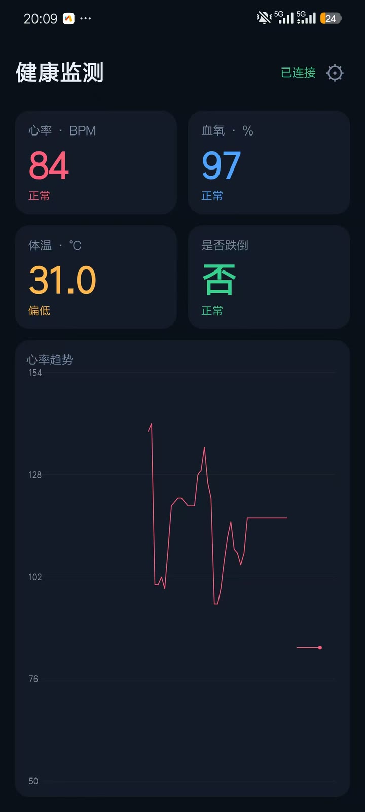
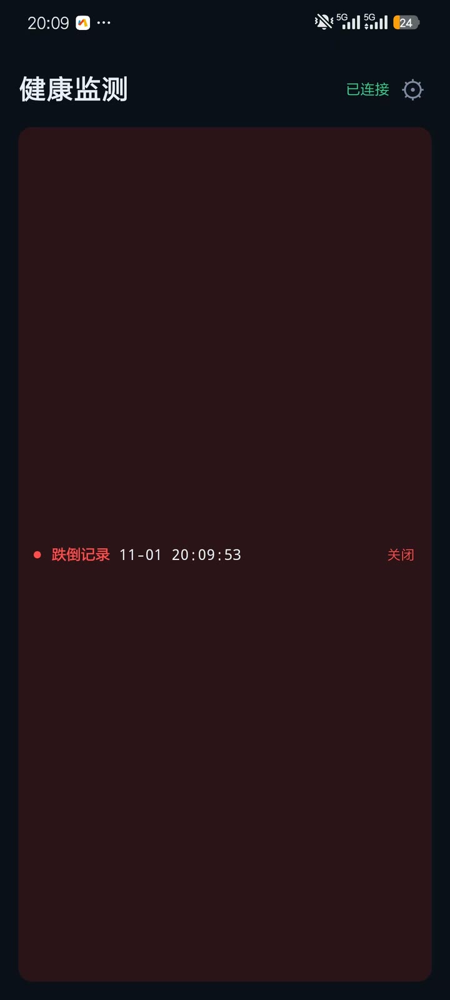
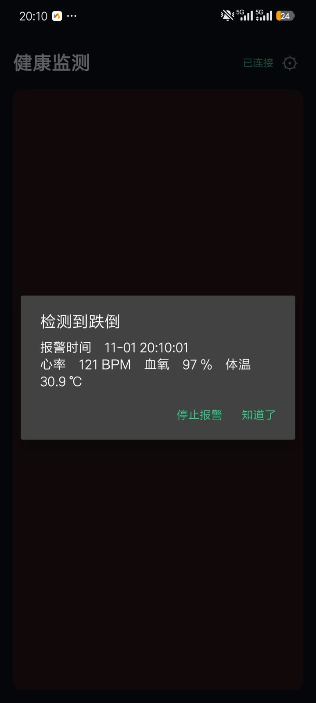
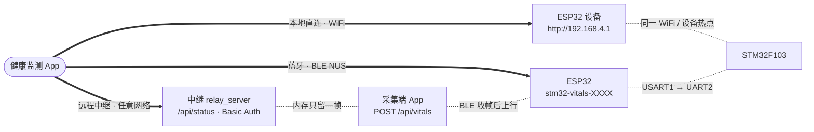
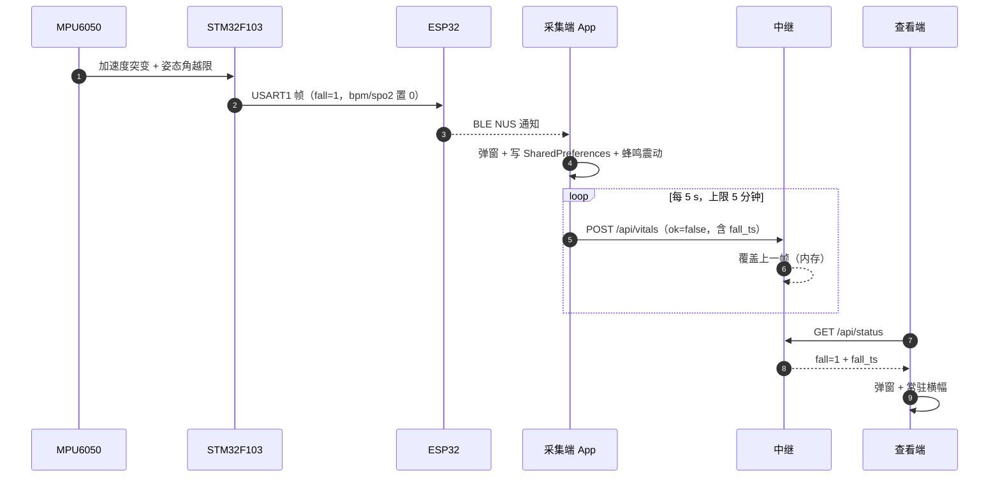

# 健康监测 App

Android 原生客户端，只做一件事：把 STM32 采集的**心率 / 血氧 / 体温 / 跌倒**四种读数显示出来。

源码为本地工程，不入本仓库；成品 APK 随 [Releases](https://github.com/PandaGuGu/stm32-health-monitor/releases) 分发。

| 项 | 值 |
|---|---|
| 包名 | `com.sit.vitals` |
| 当前版本 | `0.0.8`（`versionCode 7`） |
| 最低系统 | Android 7.0（API 24） |
| 依赖 | 无第三方库：`BluetoothLeScanner` / `HttpURLConnection` / `SQLiteOpenHelper` / 自绘 View |
| 体积 | 41 437 B |

## 界面

首页只有读数：状态灯、四张指标卡、心率趋势。链路选择、地址、账号密码、帧计数、清库都收进右上角【设置】。

<table>
<tr>
<td align="center"><br><sub>监测面板</sub></td>
<td align="center"><br><sub>跌倒记录横幅</sub></td>
<td align="center"><br><sub>跌倒弹窗</sub></td>
</tr>
</table>

指标卡按阈值变色：心率低于 60 或高于 100、血氧低于 95、体温高于 37.3 ℃、跌倒为「是」，对应卡片转高亮。
体温一栏在 31 ℃ 附近显示「偏低」，这是 DS18B20 贴在散热面上、未与皮肤接触时的正常读数。

## 三种连接方式

App 不假设数据从哪来——三条链路收帧后交给同一个解析函数，因此界面上只有状态文字不同。



| 连接方式 | 数据来源 | 需要什么 | 上行云端 |
|---|---|---|---|
| 本地直连 | 设备自带 HTTP（`:80`） | 手机与设备同网，或连设备热点 | 否 |
| 远程中继 | 中继 `/api/status` | 中继地址 + 账号 + 密码 | 否 |
| 蓝牙 | BLE 通知帧（约 132 B / 2 s） | 蓝牙权限，不需要网络 | 可选，默认关 |

## 设置项与档位的对应关系

每一档只显示它真正会用到的输入项，避免同一个地址填两遍。

| 设置项 | 本地直连 | 远程中继 | 蓝牙 |
|---|:--:|:--:|:--:|
| 服务器地址 + 连接按钮 | ● | | |
| 云端地址 | | ● | ● |
| 云端账号 / 密码 | | ● | ● |
| 「蓝牙连上后自动上传云端」开关 | | | ● |
| 本地历史（条数 / 清空） | ● | ● | ● |
| 诊断（帧计数 / 帧龄 / 固件版本） | ● | ● | ● |

远程中继档的读取地址与云端分组的地址是同一个值，不存在第二份副本；旧版本单独存过的地址在首次打开设置页时自动迁移。

## 跌倒报警

跌倒后手指离开 MAX30102，信号质量门控立即失效，读数会在下一帧变成「无读数」。
如果沿用「只上报有效帧」的规则，最要紧的这一帧会被丢掉，因此报警走独立通道。

| 环节 | 行为 |
|---|---|
| 触发 | STM32 判定跌倒，`fall` 由 0 变 1 |
| 弹窗 | 立即弹出，显示报警时间与最近一帧读数；无有效读数时直写「当前无有效读数，可能已离开传感器」 |
| 常驻横幅 | 首页标题下方保留一条，内容为「跌倒记录 + 报警时刻 + 关闭」；跌倒恢复后外观不变 |
| 清除 | 只有横幅右侧「关闭」能清除；弹窗按钮不影响记录 |
| 云端重发 | 报警期间每 5 s 推一帧，蓝牙断开照推，上限 5 分钟；帧内附 `fall_ts`（`MM-dd HH:mm:ss`）与 `fall_ms`（epoch 毫秒） |
| 去重 | 上一条未关闭且发生在 10 分钟内，视为同一场跌倒，沿用原时刻；否则覆盖为新时刻 |
| 持久化 | 记录存 `SharedPreferences`，杀进程、重启 App 后仍在 |



报警帧的 `bpm` / `spo2` / `temp` 照实为 0，不填残值——查看端据此显示「无有效读数」而不是一个假数字。

## 数据与存储

| 项 | 规则 |
|---|---|
| 落地位置 | 本机 SQLite，一张表 `hist(ts, bpm, spo2, temp, fall)` |
| 保留期 | 7 天，每次写入顺带删除过期行 |
| 降采样 | 两次入库间隔小于 5 s 的帧丢弃 |
| 入库条件 | 仅 `ok == true` 且 `bpm > 0`；无读数帧不入库 |
| 云端 | 中继不落盘，只留最新一帧；历史只在本机 |
| 趋势图 | 启动时用本机历史预热，重启后曲线不空白 |

## 构建与安装

```bash
cd host/app-vitals            # 本地工程，不入库
bash build-apk.sh             # 产出 app-vitals.apk
```

构建脚本直接调用 `aapt2` / `d8` / `apksigner`，不依赖 Gradle 守护进程；`minSdk 24 / targetSdk 35`，使用 debug 签名，`adb install -r` 即可覆盖安装。

从 Releases 下载后侧载：

```bash
adb install -r app-vitals-v0.0.8.apk
```

连续多个版本的 APK 体积都是 41 437 B（压缩产物对齐结果），**判断新旧看 `versionCode`，不要看文件大小**。

## 已知限制

- 报警重发只在首页可见时运行；锁屏或切后台会暂停，长期后台报警需要前台服务
- 一个中继只服务一个采集端，两台手机同时上报会互相覆盖同一帧
- 明文 HTTP 部署时，账号密码在链路上仅 base64 编码；异地使用请套 TLS（见 [remote/README.md](../../remote/README.md)）
- 心率 / 血氧来自 Maxim 参考算法，跌倒阈值按实测标定，均未经临床验证

## 相关文档

- 三档链路的整体设计：[docs/architecture.md](../architecture.md)
- 中继部署与帧龄算法：[remote/README.md](../../remote/README.md)
- ESP32 侧 BLE 实现与踩坑：[firmware/esp32/README.md](../../firmware/esp32/README.md)
