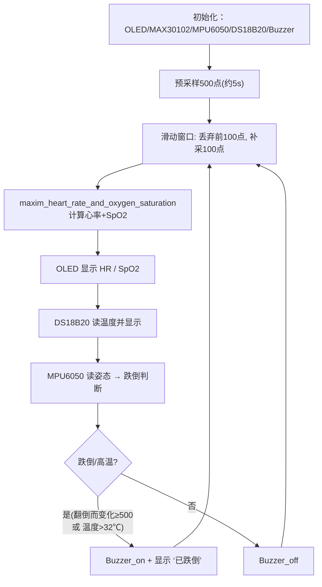

# 架构设计

> 硬件事项见 [board/schematic.md](../board/schematic.md)；**系统级原理图见 [系统原理图_v1.0.svg](schematic/系统原理图_v1.0.svg)**（引脚分配表见[配套说明](schematic/系统原理图_v1.0.md)）。本文件说明固件架构、数据流、跌倒算法与 ESP32 扩展方案。

## 1. 技术基线

- 主控：**STM32F103C8T6**（蓝板/最小系统，64KB Flash），**72MHz**（8MHz HSE ×9 倍频）。
- 代码基线：**正点原子标准外设库(SPL)** Keil 工程（`firmware/MAX30102`，工程名 `IIC`）。
  - 编译器 V5.06，器件 STM32F103C8，`CreateHexFile=1`，输出 `OBJ/IIC.hex`。
- 本机构建产物/交接物：**Hex** 首行 `:020000040800F2`，目标 Flash `0x0800 0000`。

## 2. 目录职责

```
firmware/MAX30102/
├─ CORE/              Core 启动：core_cm3、startup_stm32f10x_md.s（medium density）
├─ HARDWARE/          板级驱动（本项目核心，均相对 USER 引用）
│  ├─ BUZZER/         有源蜂鸣器 Buzzer.c/.h
│  ├─ DS18B20/        单总线温度 ds18b20.c/.h
│  ├─ IIC/            软件 I2C + MAX30102 + Maxim 算法
│  │   ├─ myiic.c     软件 I2C 时序（动手写）
│  │   ├─ max30102.c  MAX30102 驱动（FIFO 读、寄存器初始化）
│  │   └─ algorithm.c 心率/SpO2 计算算法（Maxim）
│  ├─ LED/            （未用）板载灯驱动
│  ├─ MPU6050/        MPU6050 驱动（含寄存器定义）
│  └─ OLED/           SSD1306 软驱动 + 中文字库（OELD_Data.c）
├─ STM32F10x_FWLib/   正点原子标准库 3.5
├─ SYSTEM/            delay / sys / timer / usart（正点原子底层）
├─ USER/              main.c + Keil 工程 IIC.uvprojx
└─ OBJ/               编译产物（.axt/.hex/.o，已 gitignore）
```

**仿真变体**：`firmware/MAX30102_sim/` 是同一套工程的副本（目录结构、驱动、库完全相同），
只把 `USER/main.c` 换成仿真逻辑，并用它编译出 `sim/proteus/IIC.hex` 供 Proteus 加载。
两者的差异、数据来源与限制见 [debug/10-仿真固件说明.md](debug/10-仿真固件说明.md)。
实物固件与仿真固件互不覆盖。

## 3. 主循环数据流（`USER/main.c`）



### 时序要点
- 心率采样为**阻塞式轮询** `while(MAX30102_INT==1)`，100 sps × 500 点缓冲 → 每 5s 出一次结果，非实时连续。
- OLED 整屏 `OLED_Update()` 刷新，与采样循环交替执行。

## 4. 跌倒检测算法（现状与改进）

**现状（原源码）**：仅用 MPU6050 的 `AX/AY` 变化量做阈值判断（增量 ≥500 判跌倒），且把"贴体温 ≥32℃"当作预警。

```c
if (Last_AX - AX >=500 || AX - Last_AX >=500 || Last_AY - AY >=500 || AY - Last_AY >=500)
    // 判定跌倒 → Buzzer_on
else if (Temp > 32)   // 用户体表温度过高 → 预警
    // Buzzer_on
```

**缺点**：忽略 Z 轴与角速度 GZ；仅看单次增量易误判；未做自由落体/撞击/躺卧的三段式判别。

**改进建议（后续迭代）**：
1. 加速度模长 `|a| = sqrt(AX²+AY²+AZ²)`，做 **自由落体**(|a|≈0)→**撞击峰**(>2.5g)→**姿态躺卧** 三段状态机。
2. 引入 GZ 角速度与 DMP/归一化方向，判别站立 vs 平躺差异。
3. 去抖动（连续 N 帧确认）与报警自动复位/提示确认，降低误报。

## 5. ESP32 第二主板集成

- 目前 `USART1(PA9/PA10)` **未占用**，仅启用 `SYSTEM/usart` 底层，便于作为 STM32→ESP32 的数据链路。
- 建议格式：每周期输出一行 `CSV` 或 `JSON`，例如：

```
{"bpm":75,"spo2":98,"temp":36.5,"fall":0}
```

- ESP32 侧可负责 WiFi/蓝牙、云平台上报、App 推送；STM32 仅做采集与本地报警。

### 5.1 已落地（v0.2.0）：ESP32 先做"信息节点"

为了不让"串口 + 联网 + 上位机"三件事互相掩盖，ESP32 先独立成一个只采自己状态的信息节点，
协议与双端上位机先跑通，再回头接 STM32 的 `USART1`：

| 内容 | 位置 |
|---|---|
| 固件（Arduino，WROOM-32，零第三方库） | [`firmware/esp32/esp32_info_node/`](../firmware/esp32/esp32_info_node/) |
| 协议 v1（JSON Lines 上行 / 文本命令下行） | [esp32/protocol.md](esp32/protocol.md) |
| 架构取舍与接入路径 | [esp32/architecture.md](esp32/architecture.md) |
| 上位机（网关 + Web + Android） | [`host/`](../host/), [host/README.md](../host/README.md) |

接入 STM32 时的增量很小：ESP32 侧多一路 `UART2(GPIO16/17)` 解析 STM32 的 JSON，
并入 `telemetry.vitals`；上位机加一张卡片即可，其余链路不动。

## 6. 构建

两条并行的构建路径：

```powershell
# A. Keil MDK（原始工程，需 Keil 授权）
powershell -ExecutionPolicy Bypass -File scripts\build.ps1
```

```bash
# B. arm-none-eabi-gcc（无需 Keil 授权，见 firmware/MAX30102/gcc/README.md）
cd firmware/MAX30102/gcc
SHELL=/usr/bin/bash mingw32-make.exe -j4        # IIC  原业务固件
SHELL=/usr/bin/bash mingw32-make.exe -j4 APP=1  # APP  业务固件（已实测跑通）
```

编译结果：`0 Error(s), 0 Warning(s)`。原先 `main.c` 里未使用的 `temp_num`、`str` 两个变量已删除
（GCC 缺省目标实测零告警；Keil 侧同一原因，属纯声明清理、无功能影响）。

## 7. 已知注意点

- `MAX30102` 采用软件 I2C（`PBout(7)/PBout(8)`），对引脚翻转时序要求高，改动时勿直接换硬件 I2C1（PB7/PB8 不是合法 I2C1 组合）。
- 采样为阻塞轮询，主循环整体占满，实时性有限；如需与 ESP32 同时工作，建议把采样改到中断/定时器节拍。
- **无超时死等**是黑屏/全部功能失效的根因，接线缺失时会永久卡死：
  | 位置 | 代码 | 触发条件 |
  |---|---|---|
  | `HARDWARE/DS18B20/ds18b20.c:68-69` | `while(...)` ×2 | DS18B20 不在线（`ds18b20_init()` 内） |
  `gcc/app/app_main.c`（`make APP=1`）已用带超时的本地实现规避该处，详见调试记录。

## 8. 调试记录

实机调试过程、证据链与故障速查表见 **[`docs/debug/`](debug/README.md)**（10 份报告）。
ESP32 与上位机的调试记录见 **[`docs/esp32/debug.md`](esp32/debug.md)**（13 条速查表 + 真机命令回归）。

## 9. TODO / 待办

> 按优先级排列；勾选即表示已推进。硬件事项的前提见 [board/schematic.md](../board/schematic.md) 的「搭建前确认清单」。

- [ ] **跌倒算法改进**：当前仅 AX/AY 增量阈值 + 高温预警，误判多。改为三段式状态机：自由落体(|a|≈0) → 撞击峰(>2.5g) → 姿态躺卧，派生成 `GZ` 角速度并使用连续 N 帧去抖。
- [ ] **心跳采样改造**：从阻塞轮询(100sps/500点)改为中断/定时器节拍驱动，摆脱"每 5s 才更新"的阻塞，便于实时刷新。
- [ ] **清零 CPU 占用**：`MAX30102` 软件 I2C 主循环占满，需评估加入空闲节拍。
- [ ] **ESP32 第二主板打通**：利用预留 USART1(PA9/PA10)，按 CSV/JSON 格式上行
      `{"bpm":75,"spo2":98,"temp":36.5,"fall":0}`；ESP32 侧负责 WiFi/云上报/App 推送。
      → **v0.2.0 已推进一半**：ESP32 信息节点固件 + Web/Android 双端上位机已完成并跑通
      （[docs/esp32/](esp32/architecture.md)），剩 STM32 `USART1` → ESP32 `UART2` 的对接与真机复验。
- [x] **消除编译告警**：已删除 `main.c` 中未使用的 `temp_num`、`str`，把 `0 Error, 2 Warning` 收敛到 **0 告警**（`make` 缺省目标复验通过）。
- [x] **配置校验表落地**（部分）：实测确认 OLED 模块可用（PA5/PA6，I2C）、蜂鸣器为**有源**（开机短鸣两声可闻）、MPU6050 板载上拉存在；MAX30102/DS18B20 上拉待补。详见 [调试记录 · 当前状态](debug/README.md#四当前状态)。