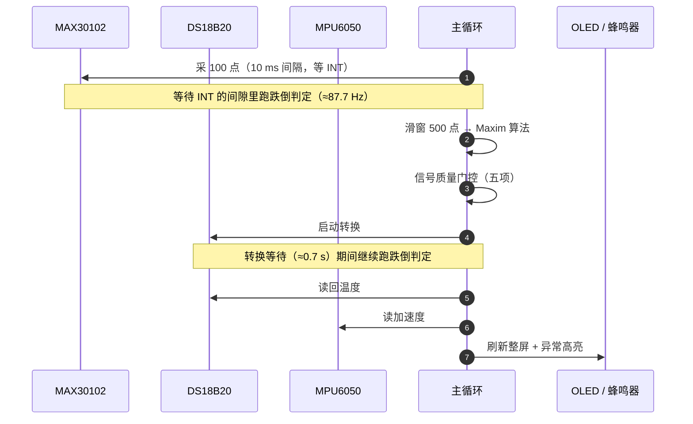
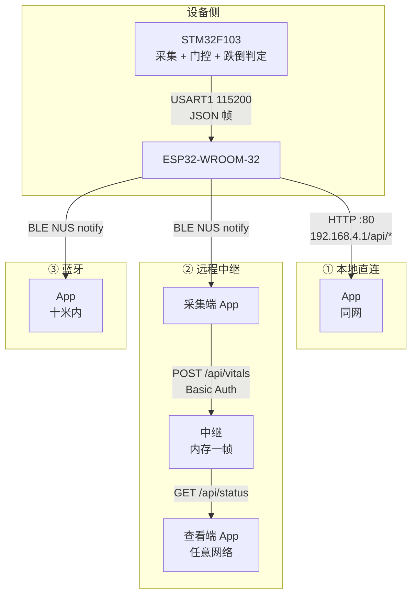

# 架构设计

> 硬件接线见 [board/schematic.md](../board/schematic.md)；系统级原理图见
> [系统原理图_v1.1.svg](schematic/系统原理图_v1.1.svg)（引脚分配表见[配套说明](schematic/系统原理图_v1.1.md)）。
> 本文说明固件架构、帧周期、门控与跌倒判定，以及三条数据链路的组织方式。

## 1. 技术基线

- 主控：**STM32F103C8T6**（蓝板最小系统，64 KB Flash），**72 MHz**（8 MHz HSE ×9）
- 代码基线：**正点原子标准外设库（SPL）** Keil 工程 `firmware/MAX30102`（工程名 `IIC`）
  - 编译器 V5.06，器件 STM32F103C8，`CreateHexFile=1`，输出 `OBJ/IIC.hex`
- 构建产物：Hex 首行 `:020000040800F2`，烧录地址 `0x0800 0000`
- 联网协处理器：**ESP32-WROOM-32**，Arduino 框架，通过 `USART1(PA9/PA10)` 与 STM32 相接

## 2. 目录职责

```
firmware/MAX30102/
├─ CORE/              启动文件：core_cm3、startup_stm32f10x_md.s（medium density）
├─ HARDWARE/          板级驱动
│  ├─ BUZZER/         有源蜂鸣器
│  ├─ DS18B20/        单总线温度
│  ├─ IIC/            软件 I2C + MAX30102 + Maxim 心率/血氧算法
│  │   ├─ myiic.c     软件 I2C 时序（带超时）
│  │   ├─ max30102.c  FIFO 读取与寄存器初始化
│  │   └─ algorithm.c Maxim 参考实现
│  ├─ MPU6050/        加速度计驱动
│  └─ OLED/           SSD1306 软驱动 + 中文字库
├─ STM32F10x_FWLib/   标准库 3.5
├─ SYSTEM/            delay / sys / timer / usart
├─ USER/              main.c + Keil 工程 IIC.uvprojx
└─ OBJ/               编译产物（已 gitignore）
```

**仿真变体**：`firmware/MAX30102_sim/` 是同一套工程的副本，结构与驱动完全相同，只把 `USER/main.c`
换成仿真逻辑，编译产物供 Proteus 加载。两者的差异与数据来源见
[debug/10-仿真固件说明.md](debug/10-仿真固件说明.md)。实物固件与仿真固件互不覆盖。

## 3. 帧周期与主循环

一帧 ≈ **1.92 s**：MAX30102 采 100 点（100 sps，约 1.0 s）＋ DS18B20 转换等待（约 0.7 s）＋ 其余约 0.2 s。
DSP 窗口是 500 点、100 Hz 滑窗，跨度 5 s，每帧向前推进 100 点。



跌倒判定挂在两段**纯等待**里（等 MAX30102 的 INT、等 DS18B20 转换），因此判定频率从每圈一次
提升到 **87.7 Hz**，且不占用采样时间——真跌倒的冲击只有几十毫秒，0.52 Hz 的判定必然漏掉。

## 4. 信号质量门控与显示策略

无手指时 IR 通道的直流分量只有约 490 LSB，算法仍会算出一个数字，直接显示就是假读数。
门控要求下列五项同时成立才认为该帧有效：

| 判据 | 阈值 |
|---|---|
| IR 直流分量 | 8 000 – 250 000 LSB |
| 交流分量幅度 | ≥ 150 LSB |
| 灌流指数 PI | 3 – 200 ‰ |
| 最近一次接触 | 0.5 s 内 |
| 心率区间 | 30 – 220 bpm |

显示遵循 **hold-last**：门控失败时保留最后一次有效读数，同时清空滑动窗口；恢复接触后重新积累。
之所以不用「—」占位，是因为监护场景中读数闪烁比读数滞后更容易被误读。

异常项用反色高亮：心率低于 60 或高于 100、血氧低于 95、跌倒为「是」。屏幕是单色 SSD1306，
没有颜色可用，反色是唯一能拉开对比度的手段。

## 5. 跌倒判定

```c
dev = | |a| - 2048 |            // 静止时 |a| ≈ 1g ≈ 2048 LSB
if (dev >= 3072)  → 判定跌倒     // ≈ 2.5g，静止最大偏差仅 119 LSB，余量约 26 倍
```

| 项 | 取值 | 依据 |
|---|---|---|
| 判据 | 加速度模长偏差 `dev ≥ 3072 LSB` | 由实测步态与撞击数据定标，单轴 500 LSB 的旧阈值漏判严重 |
| 判定频率 | 87.7 Hz | 挂在两段等待循环内 |
| 零值保护 | 三轴全为 `0x00` 时跳过 | MPU 未就绪时 `\|a\|=0`，偏差恰好 2048，会每拍误报 |
| 高温预警 | 已关闭 | 原 `else if (Temp > 32)` 会把正常体表温度当异常，蜂鸣器改由跌倒单独驱动 |

阈值与判定频率均可在线调整，无需重烧，方法见
[debug/07-跌倒判定优化_v2.5.md](debug/07-跌倒判定优化_v2.5.md)。

## 6. 三条数据链路

三条链路并存，同一份固件、同一个 App，切换只改设置项。



### 6.1 本地直连

ESP32 自带 HTTP 服务，App 直接打设备地址。中间不经过任何服务器，也不需要电脑。
适用于实验台调试与答辩演示：手机连同一路由器，或连设备热点 `esp32-info-XXXX`。

### 6.2 远程中继

异地场景下两端不需要互相可达：采集端 App 通过 BLE 收帧后把 `vitals` POST 到公网中继，
查看端 App 轮询中继取最新一帧。

上行执行者是 App 而不是 ESP32——设备因此不需要 WiFi 凭据，也不必在 BLE 与 WiFi 之间争抢射频。

帧龄由两段相加：设备侧 `age_ms`（距最后一次有效帧）＋ 中继侧滞留（距最后一次 POST）。
设备侧为 `null` 时直接判无读数，否则 STM32 断线而采集端仍在定时上报时，查看端会把旧读数当成实时值。

中继不落盘，进程退出即清空；7 天历史保存在采集手机本地的 SQLite 里。

| 内容 | 位置 |
|---|---|
| 中继服务（纯标准库，Basic Auth） | [`remote/relay_server.py`](../remote/relay_server.py) |
| 部署、帧龄算法与故障速查 | [remote/README.md](../remote/README.md) |
| 上行客户端与本地历史 | App `CloudClient` / `Store`（本地工程，不入库） |

### 6.3 蓝牙

ESP32 以 Nordic UART Service 外设身份广播 `stm32-vitals-XXXX`，连接后每 2 s 通知一帧
（与 `/api/status` 的 `vitals` 段同构，约 132 字节）。不连 WiFi、不开热点、不经过服务器。

固件侧 `ble_link.{h,cpp}`，编译需 `-Define ENABLE_BLE=1` 并使用 `huge_app` 分区（BLE 栈让固件涨到约 1.73 MB）。

### 6.4 三条链路的收敛点

三条链路收帧后交给同一个解析函数，界面只有状态文字不同。这样的好处是新增链路不需要改显示层；
代价是链路的差异（是否需要鉴权、是否有帧龄字段）必须在解析前归一，否则会出现「某条链路永远显示 `—`」。

## 7. 构建

```powershell
# A. Keil MDK（需 Keil 授权）
powershell -ExecutionPolicy Bypass -File scripts\build.ps1
```

```bash
# B. arm-none-eabi-gcc（无需 Keil 授权）
cd firmware/MAX30102/gcc
SHELL=/usr/bin/bash mingw32-make.exe -j4         # 业务固件（含 MAX30102）
SHELL=/usr/bin/bash mingw32-make.exe -j4 APP=1   # 业务固件（拆分后入口）
SHELL=/usr/bin/bash mingw32-make.exe -j4 LIVE=1  # 实时诊断（每 3 s 全量复扫）
SHELL=/usr/bin/bash mingw32-make.exe -j4 DIAG=1  # 一次性诊断
```

编译结果 `0 Error(s), 0 Warning(s)`。原先 `main.c` 中未使用的 `temp_num`、`str` 已删除，
属纯声明清理、无功能影响。变体说明见 [firmware/MAX30102/gcc/README.md](../firmware/MAX30102/gcc/README.md)。

## 8. 已知注意点

- **MAX30102 走软件 I2C**（`PBout(7)/PBout(8)`），对引脚翻转时序敏感；PB7/PB8 不是合法的硬件 I2C1 组合，不能直接换过去
- **采样为阻塞轮询**，主循环整体占满。CPU 占用的真源是 `delay_us/delay_ms` 的 SysTick 忙等，不是软件 I2C
- **无超时死等是黑屏的根因**：接线缺失时 `DS18B20/ds18b20.c` 的 `while(...)` 会永久卡死，`gcc/app` 变体已改为带超时的本地实现
- **MPU6050 的 INT 引脚未接线**，姿态数据只能轮询；若要做数据就绪中断需先补线
- **陀螺仪从未被读取**：`GYRO_CONFIG=0x18` 已配 ±2000 °/s，但寄存器 `0x43..0x48` 无任何访问，姿态判别因此缺少角速度维度
- **MAX30102 中断源未使能**：`INTR_ENABLE_1(0x02)` 从未写入，固件靠轮询 INT 电平取数
- **全工程零定时器、零 NVIC**：SysTick 仅被 `delay_*` 以「用完即关」方式占用

## 9. 调试记录

实机调试过程、证据链与故障速查表见 [docs/debug/](debug/README.md)（10 份报告）；
ESP32 与上位机的记录见 [docs/esp32/debug.md](esp32/debug.md)（13 条速查表 + 真机命令回归）。

## 10. TODO

- [ ] **陀螺仪接入**：读取 `0x43..0x48`，把角速度并入跌倒判别，区分「快速坐下」与「跌倒」
- [ ] **采样改造为中断/定时器驱动**：摆脱阻塞轮询，同时释放 CPU 给 ESP32 串口
- [ ] **跌倒三段式状态机**：自由落体 → 撞击峰 → 姿态躺卧，用连续 N 帧去重压低误报
- [ ] **环境温度补偿**：DS18B20 未接触皮肤时读数偏低，需要区分「体表温」与「环境温」两种语义
- [x] **消除编译告警**：`main.c` 中未使用的 `temp_num`、`str` 已删除，收敛到 0 告警
- [x] **跌倒判定频率与阈值**：0.52 Hz → 87.7 Hz，阈值改为 `|a|` 偏差 3072 LSB（[报告](debug/07-跌倒判定优化_v2.5.md)）
- [x] **PPG 信号质量门控**：五项判据 + hold-last 显示（[报告](debug/08-PPG信号质量门控与心率滤波_v2.6.md)）
- [x] **ESP32 对接**：`USART1 → UART2` 已打通，约 2 s 一帧、坏帧 0.25%
- [x] **三条链路**：本地直连、远程中继、蓝牙均已实测跑通
