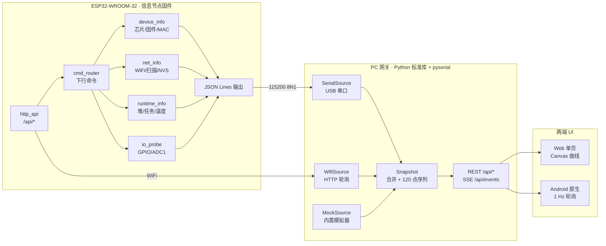
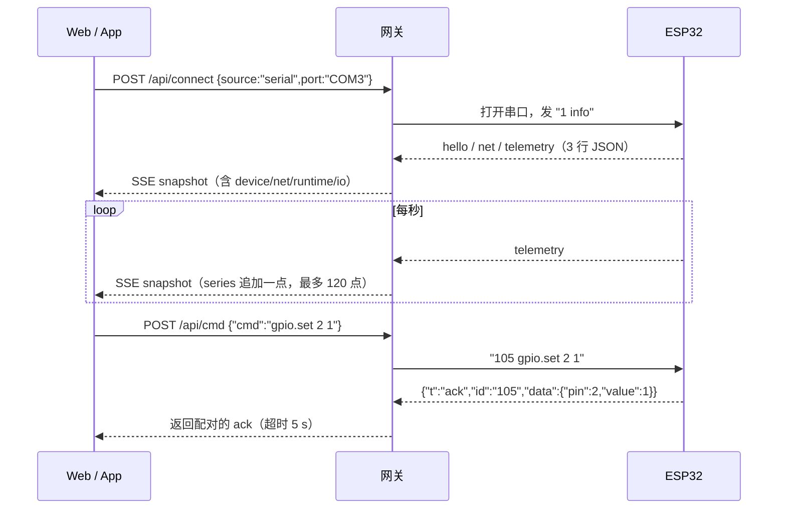

# ESP32 信息节点 · 架构与设计取舍

> 固件实现见 [firmware/esp32/README.md](../../firmware/esp32/README.md)；
> 协议字段见 [protocol.md](protocol.md)；上位机用法见 [host/README.md](../../host/README.md)。
> 原 STM32 侧架构见 [../architecture.md](../architecture.md)。

## 1. 为什么先做"信息节点"

`docs/architecture.md §5` 里 ESP32 的角色是**第二主板**：接 STM32 的 `USART1`，负责 WiFi / 云上报 / 推送。
但那个阶段一上来就要同时处理三件事——串口协议、联网、上位机，任何一环不通都会互相掩盖。

所以先把它拆成最小闭环：

| 阶段 | ESP32 职责 | 上位机职责 | 状态 |
|---|---|---|---|
| **现在（v0.2.0）** | 采自己的芯片/网络/资源/IO，吐 JSON | 把数据变成"看得懂的面板"，能下发命令 | ✅ 已完成 |
| 下一步 | 再挂一路 UART 读 STM32 的 `{"bpm":..,"spo2":..}` | 面板加一栏"生理数据" | ⏳ 待做 |
| 之后 | 云端上报 / 断线缓存 / OTA | 历史曲线、告警推送 | ⏳ 待做 |

这样每一步都有可独立验证的产物：ESP32 单独插上电脑就能看到自己的全部状态，不需要 STM32 在场。

## 2. 分层



三层各自可以独立替换：换掉 ESP32 只要还吐同一套 JSON；换掉 UI 不影响网关；没有硬件就换 `MockSource`。

## 3. 关键取舍

### 3.1 上行 JSON Lines，下行纯文本命令

- 上行用 JSON：浏览器/App/Python 都能直接解析，加字段不破坏旧代码
- 下行用 `id verb args` 文本：MCU 侧 `strtok` 就够，不引 ArduinoJson（省 4 MB Flash 的 ROM 和一次依赖管理）
- 命令带自增 `id`，`ack` 原样带回 —— 这是"请求-响应"能配对的前提，否则串口是纯单向流

### 3.2 网关放在 PC，而不是让 ESP32 当服务器

| 方案 | 问题 |
|---|---|
| ESP32 直接托管 Web | 要把前端塞进 4 MB Flash；设备 IP 一变，App/书签全失效；串口场景完全不适用 |
| PC 网关 + 两端连网关 | 串口/WiFi 都能接；前端零改动适配设备；**没硬件也能用模拟器跑通** |

代价是多一个进程。但 `server.py` 单文件、只依赖 pyserial，`python server.py` 就起来了，这个代价可以接受。

### 3.3 SSE 而不是 WebSocket

浏览器 `EventSource` 原生支持、自带重连；服务端只要写 `text/event-stream` 的行，标准库即可实现。
下行命令本来就是普通 POST，不需要长连接承载。**少一个依赖 = 少一个装不上的理由**
（这台机器上 pip 直连 PyPI 是被挡的，见 [debug.md](debug.md)）。

### 3.4 内置模拟器与真机同构

`MockSource` 不是"假页面"，而是**假设备**：它按同一份协议产生 `hello/telemetry/net/scan/ack`，
甚至模拟 GPIO 状态、ADC 抖动、AP 丢包和 `reboot` 后的时间归零。
所以 Web/App 里没有任何 `if (mock)` 分支 —— 插上真板子只换数据源，界面代码一行不改。

## 4. 数据流



断线处理：串口读异常 → 2 s 后重开；WiFi 轮询失败 → 1 s 后重试，连续失败才标记离线；
UI 侧保留最后一次快照（灰显），不会白屏。

## 5. 与 STM32 的最终拼装

STM32 的 `USART1(PA9/PA10)` 原本完全没占用（`Serial` 是 USB 那一路，GPIO1/3 保留），现在把它接起来：

```
STM32 USART1(PA9/PA10) ──115200──▶ ESP32 UART2(GPIO16/17)
                                    │
                                    ├─ 解析 {"bpm":75,"spo2":98,"temp":36.5,"fall":0}
                                    └─ 并入本节点 telemetry：{"vitals":{...}}
```

### 5.1 接线（三根线）

```
STM32 PA9  (USART1_TX) ──▶ ESP32 GPIO16 (UART2_RX)
STM32 PA10 (USART1_RX) ◀── ESP32 GPIO17 (UART2_TX，预留回传)
STM32 GND              ──── ESP32 GND
```

GPIO16/17 已被 `uart_link` 占用，`gpio.set` / `gpio.mode` 对这两个脚返回 `pin_uart`，
避免调试时手滑把数据链路打断。

### 5.2 已实现（v0.2.0）

| 位置 | 内容 |
|---|---|
| `firmware/MAX30102/USER/main.c` | `vitals_uart_init()` + 每周期 `vitals_emit(bpm, spo2, temp_raw, fall)` |
| `firmware/MAX30102/gcc/app/app_main.c` | 同上（GCC 变体，逻辑一致） |
| `firmware/esp32/.../uart_link.*` | UART2 收行 → 极简 JSON 取值 → 合理性校验 → 进 `telemetry.vitals` |
| 网关 `protocol.py` | `vitals` 从 telemetry 提到 snapshot 顶层，并把 `bpm/spo2` 并入 `series` |
| Web / App | 「生理数据 · STM32」卡片：心率/血氧/体温/跌倒/帧龄/来源 + 心率曲线 |
| `host/tools/stm32_sim.py` | 无 STM32 时的替身：可走网关注入，也可走真串口喂 UART2 |

三个实现细节：

1. **STM32 侧不用 `printf`**：Keil 工程没有重定向 `fputc`，microlib 的 `printf` 会走半主机调用直接挂死；
   改成自己发字节 + 自己转数字（`vitals_send` / `vitals_u2s`），两套构建都安全，也不依赖 `SYSTEM/usart/usart.c`
   （该文件并未加入 Keil 工程，直接调 `uart_init()` 会 `L6218E: Undefined symbol`）
2. **坏帧不覆盖旧值**：`bpm` 缺失或 `bpm/spo2` 越界只计 `bad`，保留上一帧；8 s 无新帧才置 `ok=false`
   （STM32 一帧 5–6 s，阈值留 2 s 余量）
3. **可以无 STM32 验收**：`vitals.sim` 注入走的是与真串口**同一个** `feedLine()`，所以"解析→网关→双端 UI"
   这一整段现在就能验完，接上板子只多验"电平、波特率、共地"三件事

## 6. 目录职责

```
firmware/esp32/esp32_info_node/   固件（Arduino，8 个模块，零第三方库）
host/gateway/                     protocol.py(协议/合并) sources.py(三源) server.py(HTTP+SSE)
host/web/                         index.html + style.css + app.js（无构建）
host/app/                         Android 原生 Java（MainActivity/Ui/SparkView/GatewayClient）
docs/esp32/                       本文件 + protocol.md + debug.md + 截图
scripts/build-esp32.ps1           编译/烧录
```

## 7. 验证记录（2026-10-18）

前一列是模拟数据下的验证，后一列为**真机（ESP32-D0WD-V3 / COM3 / 4 MB）**复验：

| 项 | 结果 |
|---|---|
| 固件编译 | `esp32:esp32:esp32`，807 941 B（61% Flash）/ 45 568 B RAM（13%），**0 error 0 warning** |
| 烧录 | `arduino-cli upload` 814 512 B / 8.1 s，Hash verified；烧前已全片备份 4 194 304 B |
| 首帧 | 上电 500 ms 内 `net` + `hello` + `telemetry`；`hello` 自报的型号/rev/Flash/MAC 与 `esptool flash_id` 完全一致 |
| 串口链路 | ✅ 真机：1 Hz 遥测连续、`gpio.set/get`、`adc.get`、`interval`、`scan`、`reboot` 全部返回配对 `ack` |
| 命令回归 | ✅ 21 条全通（含 4 条 `vitals.*`）；`scan` 扫到 6 个真 AP（含 WPA3 / OPEN / 隐藏 SSID）；`reboot` 后 `reset=sw`、网关 `reconnects=0` |
| Web 面板 | ✅ 真机数据渲染：型号/MAC/堆/温度/任务数、真 AP 列表、引脚点击 ack，**0 控制台报错** |
| Android App | ✅ MuMu 上读到同一份真机数据（`20:50:0D:33:DA:D8`），引脚点击后网关侧核实 `gpio.12=1` |
| **STM32 上行链路** | ✅ **协议与解析已打通**：`vitals.sim` 注入 → telemetry → 网关顶层 → Web/App 卡片；STM32 两侧代码编译通过（Keil 0 error 0 warning）。**真线未接**（见下） |
| WiFi 链路 | ⏳ 设备侧 `/api/*` 已实现、AP 模式日志 `http api on :80`，**但还没从 PC 连 AP 实打实请求过** |
| 热插拔 | ⏳ 网关 3 s 重连逻辑未做真机拔插验证 |

## 8. 已知限制

- **AP 模式下 `scan` 要 6.8 s**：固件需临时切 `AP_STA` 再扫全信道，期间遥测停更（STA 模式通常 1.5–2 s）
- **芯片温度 60–62 ℃**：AP 常开 + 240 MHz 的常态，比环境高 15–20 ℃，只能看趋势
- **`frag` 基线是 ~57%**：ESP32 开 WiFi 后最大连续块仅 ~110 KB / 空闲堆 ~250 KB，阈值因此是 65/80 而非 8/20
- **GPIO 5/14/15 上电读高**：strapping 脚默认上拉，固件不主动拉低（拉低会改启动模式）
- **ADC2 不可用**：WiFi 开启时 ADC2（GPIO 0/2/4/12–15/25–27）读不出来，固件只开放 ADC1
- **App 是 1 Hz 轮询**：没做推送，后台不刷新；调试够用，做产品要换长连接
- **明文 HTTP + 无鉴权**：内网调试可以，别往公网放
- **未做长期稳定性观察**：目前真机连续运行十几分钟，`heap_min` 稳定在 242 KB

## 9. TODO

- [x] 协议定版（`protocol.md` v1）与三种数据源同构
- [x] 固件四类信息采集 + 21 条命令 + 设备侧 HTTP
- [x] Web 面板（连接/卡片/曲线/扫描/命令台/原始流）
- [x] Android App（双列自适应、引脚可点、命令台）+ MuMu 实测
- [x] **真机串口链路**：`hello` 首帧、`gpio.set` 生效、`scan`/`reboot` 全部实测通过
- [x] **STM32 上行链路（协议与解析）**：`vitals.sim` → telemetry → 网关 → Web/App 全通；STM32 侧 `vitals_emit()` 编译通过
- [ ] **接真 STM32 验线**：PA9→GPIO16、共地，确认 `vitals.src=stm32`、`age_ms` 稳定、丢帧率
- [ ] **WiFi 链路复验**：`wifi.sta` 配网 → 网关切 `--source wifi`；或 PC 连 `esp32-info-DAD8` 直接打 `/api/*`
- [ ] 拔插 USB 验证网关 3 s 自动重连
- [ ] STM32 `USART1` → ESP32 `UART2` 打通，`telemetry` 增加 `vitals`
- [ ] 历史数据落盘（SQLite/CSV），给课设报告出趋势图
- [ ] App 增加扫码配网 / 保存多台设备
