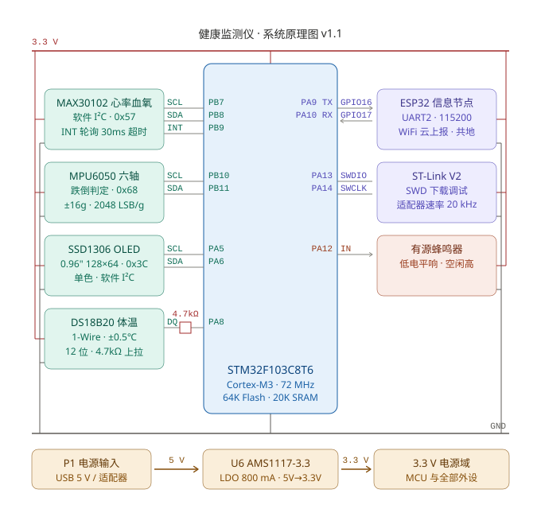

# 系统原理图 v1.1

STM32F103C8T6 健康监测仪的系统级原理图。

---

## 引脚分配表

| 位号 | 器件 | 功能 | 接口 | MCU 引脚 | 对端引脚 | 速率 / 参数 |
|---|---|---|---|---|---|---|
| U1 | STM32F103C8T6 | 控制核心 | — | — | — | Cortex-M3 · 72 MHz · 64 KB Flash / 20 KB SRAM |
| U2 | MAX30102 | 心率 / 血氧 | I²C（软件模拟） | PB7 = SCL PB8 = SDA PB9 = INT | — | 7 位地址 `0x57` RED 660 nm / IR 880 nm |
| U3 | MPU6050 | 六轴体动 · 跌倒判定 | I²C2（硬件 AF 复用） | PB10 = SCL PB11 = SDA | — | 7 位地址 `0x68` 加速度量程 ±16 g（2048 LSB/g） |
| U4 | SSD1306 OLED | 本地显示 | I²C（软件模拟） | PA5 = SCL PA6 = SDA | — | 7 位地址 `0x3C` 0.96 英寸 · 128 × 64 · 单色 |
| U5 | DS18B20 | 体温 | 1-Wire | PA8 = DQ | — | 12 位分辨率 · ±0.5 ℃ 4.7 kΩ 上拉至 3.3 V |
| BZ1 | 有源蜂鸣器 | 声报警 | GPIO | PA12 | — | 低电平驱动（空闲拉高 = 关） |
| U7 | ESP32 信息节点 | WiFi / 云上报 | USART1 → UART2 | PA9 = TX PA10 = RX | GPIO16 = RX GPIO17 = TX（预留回传） | 115200 · 两板共地 |
| J1 | ST-Link V2 | 下载 / 调试 | SWD | PA13 = SWDIO PA14 = SWCLK | SWDIO / SWCLK | 适配器速率 20 kHz |
| U6 | AMS1117-3.3 | 稳压 | — | — | — | LDO · 800 mA · 5 V → 3.3 V |
| P1 | 电源输入 | 供电 | — | — | — | USB 5 V 或 5 V 适配器 |

**注**　U4 与 U2 均为 GPIO 开漏模拟的软件 I²C，未占用硬件外设，引脚可任意重映射；U3 使用 STM32 硬件 I²C2（AF 开漏复用），时序由外设产生。U2 的 INT 为低有效，固件轮询带 30 ms 超时；U5 依赖 4.7 kΩ 上拉与 µs 级时序，上拉电阻由模块板载提供。U7 一节见 `docs/esp32/architecture.md`：STM32 侧 `USART1`（PA9/PA10）每周期发一行生理数据 JSON，ESP32 侧 `UART2`（GPIO16/17）接收，两板必须共地。图中 3.3 V / GND 为电源域母线，各模块的 VCC / GND 均就近接入。

---

## 版本记录

| 版本 | 日期 | 变更 |
|---|---|---|
| v1.0 | 2026-10-17 | 首版。按 `HARDWARE/` 层实际引脚配置绘制，含电源域、四类外设与 SWD 调试链路 |
| v1.1 | 2026-10-31 | 新增 ESP32 信息节点（USART1 PA9/PA10 ↔ UART2 GPIO16/17）；信号改为逐引脚绘制（含 PB9 INT、SWDIO/SWCLK、GPIO16/17 方向）；补 3.3 V / GND 母线与 DS18B20 上拉电阻 |
