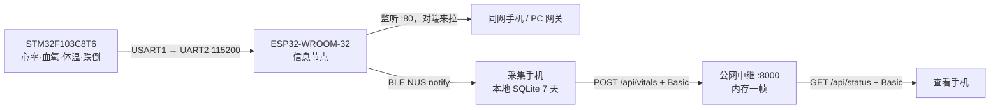

# 远程监测方案

让查看方在**任意网络**下看到设备读数的一套独立链路：采集手机通过蓝牙收帧，自身存 7 天历史，
再顺手把每一帧推给一台公网中继；另一台手机连中继取最新一帧。

它与仓库里已有的局域网方案（设备自带 HTTP + `host/` 上位机）**并列存在，互不替代**：
局域网方案跑的是"同一 WiFi 内、由对端来拉"的场景，本方案跑的是"两端不可达、只要最新一帧"的场景。

关键取舍：**上行放在 App，不在固件**。设备只负责"收 STM32 帧 + BLE 通知 + 本地 HTTP"，
外网这一段由手机完成——板子因此不需要 WiFi 凭据，也不必在 BLE 与 WiFi 之间争抢射频。

## 1. 两个方案的分工

| | 局域网方案 | 远程监测方案（本目录） |
|---|---|---|
| 手机与设备 | 必须同网：同一路由器，或连设备热点 `esp32-info-XXXX` | 任意网络，不需要可达 |
| 谁发起数据 | 对端**来拉**（ESP32 监听 80 端口） | 采集手机**主动推**，查看手机来拉 |
| 中间件 | 无（`host/gateway` PC 网关可选） | `remote/relay_server.py` 公网中继（必须） |
| 上行执行者 | ESP32 直接应答 | App：蓝牙收帧后 `POST /api/vitals` |
| 鉴权 | 无 | HTTP Basic Auth，上行与下行都校验 |
| 数据留存 | 网关进程内 + 日志文件 | 云端无留存；App 本地 SQLite 保留 7 天 |
| 延迟 | 局域网 < 100 ms | 1–3 s，取决于公网质量 |
| 断网表现 | App 连不上，直接报错 | 查看端仍能连中继，靠帧龄判定显示 `—` |
| 适用场景 | 实验台调试、答辩现场演示 | 异地看护、外出携带、家属远程查看 |
| 启动成本 | 烧完固件即可用 | 需要先架起中继，并在 App 里填账号 |



三条链路可以同时存在：ESP32 一边在 80 端口应答同网设备，一边用 BLE 广播；
蓝牙连上后 App 才开始往云端推。没有手机在旁时，云端不会有任何数据。

## 2. 组成

| 部件 | 位置 | 职责 |
|---|---|---|
| 中继服务 | [`relay_server.py`](relay_server.py) | 收 POST 存内存一帧，应答 GET；纯标准库，无第三方包 |
| 上行客户端 | App `CloudClient`（本地工程，不入库） | 蓝牙档每帧 `POST /api/vitals`；单线程、在途即丢新帧、失败节流 |
| 下行客户端 | App `VitalsClient`（本地工程，不入库） | 远程档 `GET /api/status`，带 Basic 头 |
| 本地历史 | App `Store`（本地工程，不入库） | SQLite 一张表，保留 7 天，5 s 降采样，只存有效帧 |

固件侧不含任何上报代码。这一点是有意的：设备一旦自己 POST，就必须常连 WiFi，
与 BLE 共用一套射频会导致通知丢包；而且板子上得存账号密码，换网还得重新配。

## 3. 部署

### 3.1 起中继

```bash
python remote/relay_server.py --port 8000
python remote/relay_server.py --user test1 --pass stm-esp-test1 --port 8000
RELAY_USER=test1 RELAY_PASS=stm-esp-test1 python remote/relay_server.py --port 8000
```

| 参数 | 默认 | 说明 |
|---|---|---|
| `--host` | `0.0.0.0` | 手机要连就必须是 `0.0.0.0`，不能是 `127.0.0.1` |
| `--port` | `8000` | 暴露公网时别用 80/8080，减少无差别扫描 |
| `--user` | `test1` | 也可用环境变量 `RELAY_USER` |
| `--pass` | `stm-esp-test1` | 也可用环境变量 `RELAY_PASS`；内置值只是测试账号 |
| `--stale` | `10` | 帧龄超过多少秒判为掉线（`ok=false`） |
| `--verbose` | 关 | 打开后每条请求打一行，排查连接问题用 |

接口（全部需要 `Authorization: Basic base64(user:pass)`，缺失或错误一律 401）：

| 方法 | 路径 | 说明 |
|---|---|---|
| POST | `/api/vitals` | `{"vitals":{...}}` 或扁平 `{"bpm":88,...}`；覆盖上一帧 |
| GET | `/api/status` | `{"source":"relay","vitals":{...}}`，与设备侧 `/api/status` 同构 |
| GET | `/api/latest` | 同 `/api/status` |
| GET | `/api/health` | 收帧数、坏帧数、帧龄 |

常驻（Linux）：

```ini
# /etc/systemd/system/vitals-relay.service
[Unit]
Description=vitals relay
After=network-online.target

[Service]
Environment=RELAY_USER=test1
Environment=RELAY_PASS=换成你的密码
ExecStart=/usr/bin/python3 /opt/vitals/relay_server.py --port 8000
Restart=always

[Install]
WantedBy=multi-user.target
```

没有公网 IP 时用穿透（frp / cpolar / natapp），把 `127.0.0.1:8000` 暴露出去即可；此时
`--host 127.0.0.1` 更安全，只让穿透客户端访问。

### 3.2 HTTPS

Basic Auth 的凭据只是 base64，不是加密。明文 HTTP 下抓包即可还原账号密码，
所以公网部署必须套一层 TLS。最简的是 Caddy，配置四行、证书自动续：

```caddyfile
vitals.example.com {
    reverse_proxy 127.0.0.1:8000
}
```

只有 IP 没有域名时 Let's Encrypt 签不出证书，只能自签；手机仍会提示不安全，但链路是加密的。

### 3.3 App 配置

齿轮 → 「云端（远程中继）」：

| 项 | 说明 |
|---|---|
| 地址 | `https://vitals.example.com` 或 `http://<IP>:8000`，App 自己拼 `/api/vitals`、`/api/status` |
| 账号 / 密码 | 与 `--user` / `--pass` 一致 |
| 蓝牙连上后自动上传云端 | 开关。**只有蓝牙档会上推**，本地/远程档不推（那两个档本来就在直接取数） |

查看端（另一台手机）：连接方式选「远程中继」，地址填中继地址，账号密码同上。
两端用的是同一个 APK，不需要为查看端单独编译。

## 4. 帧龄是怎么算的

这是本方案唯一需要小心的地方。云端不存数据，查看端拿到 `bpm: 88` 无法自行判断这是
刚刚的读数还是三小时前设备死掉时留下的，所以新鲜度必须在服务端串起来：

```
设备侧 age_ms（距最后一次有效帧）  +  中继侧滞留（距最后一次 POST）  =  真实帧龄
```

| POST 里的 `age_ms` | 含义 | 中继的处理 |
|---|---|---|
| 数值，如 `120` | 设备刚采到，读数有效 | 加上中继滞留，与 `--stale` 比较 |
| `null` | 明确表示"没有有效读数" | `ok` 直接置 `false` |
| 字段不存在 | 手测用的扁平报文 | 退化为中继侧滞留时间 |

只算中继侧滞留是不够的：STM32 断开但采集手机仍在每 2 s 推送时，中继每次都收到新包，
只看接收时间会一路 `ok=true`，查看端就把旧读数当成实时值。设备侧的 `age_ms` 是唯一能
穿透这一层的信号，所以 `CloudClient` 原样带上它，而不是只发四个数字。

## 5. 本地 7 天历史

云端不留数据，历史只能落在采集手机自己身上（`Store.java`）：

- 表 `hist(ts, bpm, spo2, temp, fall)`，`ts` 为主键，保留 7 天
- **5 s 降采样**：STM32 每 2 s 一帧，全量存 7 天约 30 万行；降到 5 s 后约 12 万行、几 MB
- **只存 `ok==true` 的帧**：门控失败时字段残留的是上一次的值，存进去等于造假数据
- 每小时最多清理一次窗口外的行，避免每帧全表扫描
- 时间戳用手机系统时钟，不用设备侧的 `age_ms`——后者是相对值，写进库没有意义

硬边界：**换一台手机、清掉应用数据，历史就没了**。这是"云端只转发"的必然结果。

## 6. 边界

明确不做的：

- **云端没有历史**。只保留最新一帧，进程重启即清空。
- **一个中继只服务一个采集端**。两台上报会互相覆盖，多设备就多起几个实例、用不同端口。
- **没有离线补传**。断网期间的帧直接丢弃，恢复后从当前帧继续。
- **没有告警推送**。跌倒标志会随帧送到 App 并触发震动，但不做短信/电话通知。
- **云端不认设备身份**。拿到账号的人在有效期内都能上报；需要更强隔离就在前面套带认证的反代。

什么时候必须把存储加到云端，有三个判据：需要多端看到同一份历史、需要导出给医生或写进论文、
需要换手机后仍能回看。真到那一步只需在 `do_POST` 里补一次 `INSERT`，对外接口不变。

## 7. 故障速查

| 现象 | 原因 | 处理 |
|---|---|---|
| 查看端一直 `—`，`/api/health` 的 `rx_frames` 是 0 | 采集端没在推 | 采集手机设置页诊断区看「云端上行」的 HTTP 码 |
| 上行 HTTP 401 | 账号密码与 `--user` / `--pass` 不一致 | 两边对齐，改完 App 侧直接返回即生效 |
| 上行 HTTP 404 | 地址里多写了路径 | 只填到端口，App 自己拼 `/api/vitals` |
| 上行 `UnknownHostException` / `ConnectException` | 域名解析或端口不通 | 手机浏览器打开同一地址验证 |
| 有数据但 `ok` 恒为 `false` | 设备侧 `age_ms` 是 `null` | STM32 侧没在发帧，查 PA9/PA10 与共地 |
| 数值正常但 10 s 后才变 `—` | `--stale` 偏大 | 调到 5 s，代价是弱网下误判掉线 |

## 8. 实测记录

| 项目 | 结果 |
|---|---|
| 中继端到端 | 16 项断言全通过：空态、上行无凭据 401、下行无凭据 401、密码错误 401、坏 JSON 400、帧龄叠加（设备侧 80 ms + 滞留 20 ms = 100 ms）、设备侧 `ok=false` 穿透、扁平报文兼容、滞留超时、`/api/status` 与 `/api/latest` 一致 |
| App 构建 | `bash build-apk.sh` 通过，37 341 B |
| 固件构建（`ENABLE_BLE=1` + `huge_app`） | 通过，1 732 567 B / 55% Flash，RAM 64 596 B；不含任何云端代码 |

断线场景是重点验证项：构造一个 `{"vitals":{"ok":false,"age_ms":null}}` 的 POST，
中继刚收到也必须回 `ok=false`，否则查看端会停在旧读数上。

## 9. 相关文档

- 设备侧协议（字段 / 命令 / 错误码）：[`docs/esp32/protocol.md`](../docs/esp32/protocol.md)
- 局域网方案与上位机：[`host/README.md`](../host/README.md)
- 分阶段集成思路：[`docs/architecture.md`](../docs/architecture.md) §5
